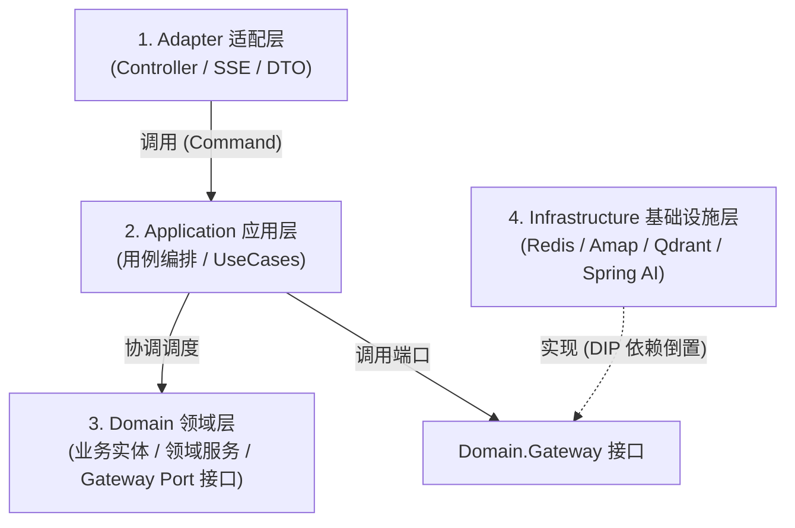

# 渝游智策 AI 后端核心架构设计与重构开发文档 (Architecture Design Document)

- **项目名称**：渝游智策 — 重庆智慧文旅 AI 决策助手后端 (`scenic-guide-ai`)
- **系统版本**：v2.0 (COLA Clean Architecture 重构版)
- **基准 Commit**：`42d69a9`
- **重构分支**：`refactor/cola-architecture`
- **日期**：2026-10-04

---

## 一、 为什么重构：现状痛点与重构动机

通过对原项目 `scenic-guide-ai`（Commit `42d69a9`）源码的深度审计，系统存在以下 4 大核心架构瓶颈：

```
【当前架构缺陷：上帝控制器 + 领域污染 + 假防腐】
                   ┌───────────────────────────────────────────────┐
                   │          com.ai.guide.domain.chat.api         │
                   ├───────────────────────────────────────────────┤
                   │ ❌ ChatController (828 行): 兼顾 HTTP 参数、  │
                   │    RAG 决策、Prompt 拼装、SSE 流式、Redis 存储│
                   └───────────────────────┬───────────────────────┘
                                           │ 直接依赖
                   ┌───────────────────────▼───────────────────────┐
                   │        com.ai.guide.domain.chat.service       │
                   ├───────────────────────────────────────────────┤
                   │ ❌ RedisChatMemory (直接依赖 RedisTemplate)   │ <--- 领域层被底层中间件污染
                   │ ❌ AmapPlannerGateway (直接依赖高德地图 SDK)  │ <--- 领域层泄漏第三方实现类
                   └───────────────────────────────────────────────┘
```

1. **控制器承担过多编排职责（上帝类 Fat Controller）**：
   * 原 `ChatController.java` 达 828 行，一人包揽了：入参校验、多租户上下文传递、意图分析、RAG 路由决策、动态 POI 探测、行程快照脱敏、上下文滑动压缩、大模型流式 SSE 协议推送、以及异步历史消息落盘。
   * 接口层与业务逻辑紧密耦合，无法独立复用或针对业务流程做纯内存测试。
2. **领域层被具体技术基础设施污染（Domain Contamination）**：
   * 按照经典领域驱动设计（DDD）与整洁架构原则，**领域层（Domain Layer）必须是最纯粹的业务核心，严禁依赖具体技术框架与第三方基础设施**。
   * 原工程中 `RedisChatMemory`（依赖 `RedisTemplate`）直接放在 `domain/chat/service`；`AmapPlannerGateway`、`AmapRouteService`（依赖高德 Web 服务）直接混在 `domain/planner/service`。
3. **接口防腐层泄漏实现细节（Leaky Abstractions）**：
   * 规划领域虽定义了 `RouteGatewayPort`，但其返回值直接引用了高德实现类内部的 POI/Candidate 数据结构，换用其他地图源会引起全域代码连锁震荡。
4. **可测性脆弱（Test Rigidity）**：
   * 大量业务测试被迫启动 Spring 上下文或配置复杂的外部 Mock，缺乏快速、纯粹的领域单元测试。

---

## 二、 核心架构设计目标 (Core Architectural Goals)

本次重构必须达成以下 **四大核心设计目标**：

| 目标维度 | 目标定义与量化指标 |
| :--- | :--- |
| **1. 职责严格正交与分层解耦** | 遵循阿里巴巴 **COLA 架构（Clean Object-Oriented & Layered Architecture）**，明确划分 Adapter、Application、Domain、Infrastructure 四层，严禁跨层违规调用与逆向依赖。 |
| **2. 外部行为与协议 100% 保真** | **黑盒等价铁律**：所有 REST 端点 URL、请求参数、返回 JSON 格式、HTTP 状态码、错误响应，以及 SSE 事件帧时序（`meta` $\rightarrow$ `sentiment` $\rightarrow$ `text` $\rightarrow$ `done`）和 `<action_chip>` XML 格式保持完全一致，**前端 Vue3 与 Node BFF 零改动平滑运行**。 |
| **3. 核心领域纯粹化与防腐隔离** | 核心业务规则（如意图雷达 `IntentRadarService`、行程拓扑约束、偏好画像策略）为 **Pure Java POJO**；第三方基础设施（高德地图、Redis、Qdrant、Spring AI 模型客户端）必须通过 Gateway 接口适配器模式实现，**更换底层 SDK 时核心业务改动为 0**。 |
| **4. 极高可测性与认识论诚实** | 核心用例与领域逻辑支持脱离 Spring 容器毫秒级纯内存单测；严格遵循《重构 SOP v2.1》，**不擅自把原有特异行为当 Bug 修，由独立的子智能体执行严苛的先 A 后 B 验收对账**。 |

---

## 三、 目标包结构蓝图与分层调用规范 (Package Layout & Rules)

```
com.ai.guide
├── adapter                          # 1. 适配层 (外部协议入口)
│   ├── chat.web                     # ChatController, HistoryController
│   ├── planner.web                  # PlannerController
│   ├── preferences.web              # PreferencesController
│   ├── trip.web                     # TripController
│   └── user.web                     # AuthController, UserController
│
├── application                      # 2. 应用层 (业务用例编排，不含底层实现)
│   ├── chat                         # ChatApplicationService, ChatStreamCommand, ChatStructuredCommand
│   ├── planner                      # PlannerApplicationService, PlanningCommands
│   ├── preferences                  # PreferencesApplicationService
│   └── trip                         # TripApplicationService
│
├── domain                           # 3. 核心领域层 (纯粹业务规则，Zero-Tech-Dependency)
│   ├── chat                         # IntentRadarService, IntentService, ChatDomainPolicy, SlotTrackingService
│   │   └── model                    # ScenicResponse, ScenicItem
│   ├── planner                      # RouteAwarePlanner, ConstraintConflictDetector, TopographyKnowledge
│   │   ├── gateway                  # RouteGatewayPort, MapServicePort (纯接口)
│   │   └── model                    # TravelConstraints, Itinerary, ScoreBreakdown
│   ├── preferences                  # UserPreferences, BudgetPreference, PreferenceConflictException
│   └── memory                       # TravelMemoryService, MemoryRecord
│
└── infrastructure                   # 4. 基础设施层 (具体技术实现，适配器)
    ├── chat                         # 聊天相关技术实现
    │   └── memory                   # RedisChatMemory (Redis 缓存与异步持久化)
    ├── map                          # 地图技术实现
    │   └── amap                     # AmapRouteService, AmapPlannerGateway (实现 RouteGatewayPort)
    ├── rag                          # 知识检索与向量库技术实现
    │   ├── qdrant                   # QdrantStoreAdapter (向量检索)
    │   └── pipeline                 # 文档切片、知识图谱提取
    └── persistence                  # 关系数据库持久化
        ├── postgresql               # MyBatis / JPA Repository 实体与持久化映射
        └── entity                   # 数据库持久化 DO 对象
```

### 依赖方向与调用规约铁律



* **规则 1**：`Adapter` 只能调用 `Application`，严禁直接跨层调用 `Infrastructure`。
* **规则 2**：`Application` 负责业务事务与用例编排，可调用 `Domain Service` 和 `Domain Gateway Port`。
* **规则 3**：`Domain` 是系统的核心资产，**绝不允许 import 任何第三方框架包（如 Spring Data Redis、Qdrant SDK、Amap SDK）**，所有外部能力均定义为 Gateway Port 接口。
* **规则 4**：`Infrastructure` 负责实现 `Domain` 定义的 Gateway Port，完成真正的技术对接。

---

## 四、 垂直切片迁移演进路线图 (Refactoring Roadmap)

根据《重构 SOP v2.1》的“试点先行，按依赖分批推进”原则，全量重构分 5 个切片有序推进：

| 批次 | 切片名称 | 迁移目标与范围 | 重点验证与验收风险 |
| :---: | :--- | :--- | :--- |
| **Slice 1 (试点)** | **Chat 对话与流式域** | 1. `ChatController` 瘦身为 Adapter；<br>2. 建立 `ChatApplicationService` 承接编排；<br>3. `RedisChatMemory` 下沉到 `infrastructure`；<br>4. 意图雷达 `IntentRadarService` 保持纯领域组件。 | SSE 事件帧时序一致性（`meta` $\rightarrow$ `text` $\rightarrow$ `done`）；<br>规划会话偏好快照隔离不污染；<br>异步落盘与分析日志上报无损。 |
| **Slice 2** | **Preferences 偏好画像域** | 1. `PreferencesController` 迁入 Adapter；<br>2. 统一偏好冲突判定 `PreferenceConflictException`；<br>3. 关系存储下沉至 infrastructure。 | 5 大 REST 动词幂等与原子性；<br>多租户 `UserContext` 越权防护；<br>与 Chat/Planner 的快照读取兼容。 |
| **Slice 3** | **Trip 行程生命周期域** | 1. `TripController` 迁入 Adapter；<br>2. 整理行程版本号、状态机流转；<br>3. 行程 JSON Schema 校验与 PDF 生成服务下沉。 | 行程草稿与正式行程隔离；<br>多版本回滚与 Schema 迁移测试。 |
| **Slice 4** | **Planner 规划引擎域** | 1. `PlannerController` 迁入 Adapter；<br>2. 规划调度核心解耦；<br>3. **彻底净化 `RouteGatewayPort`**，将高德 Candidate 转化为纯领域实体；<br>4. `AmapPlannerGateway` 下沉到 infrastructure。 | 重庆 8D 地形约束打分一致性；<br>路径规划耗时与代价计算保真；<br>规划草稿与保存连接处验证。 |
| **Slice 5** | **RAG 知识检索域** | 1. 离线数据清洗与在线检索推理分离；<br>2. Qdrant 客户端与 Embedding 适配器下沉；<br>3. 并行检索与 Query 扩展策略收敛。 | 知识可核验性标记（`verified`）；<br>未查到资料时的安全降级提示语一致。 |

---

## 五、 重构执行与人机协作标准协议 (SOP v2.1 规范)

1. **角色分工**：
   * **主智能体（实现者 / 我）**：明确当前切片范围，按上述规范编写代码，执行模块自测与主干集成。
   * **独立审查子智能体（审查者 / 质检员）**：在独立上下文中唤起，执行**“先看 A、提清单、再查 B、逐行举证”**，给出四分类判定：
     * `[已验证一致]` / `[明确获准的变化]` / `[回归差异]` / `[尚未核实]`。
2. **切斯特顿围栏法则**：
   * 严禁智能体自作主张将 A 原有的奇怪行为当作 Bug 修复；
   * 存疑的列为“疑似原有问题”记录在案，交付时提供复现步骤由用户裁决。
3. **完成判定**：
   * 必须通过全量构建与测试套件（323 个测试全部绿灯）；
   * 必须完成状态账本 `REFACTORING_LEDGER.md` 同步；
   * 必须经过独立审查子智能体验收签字。
