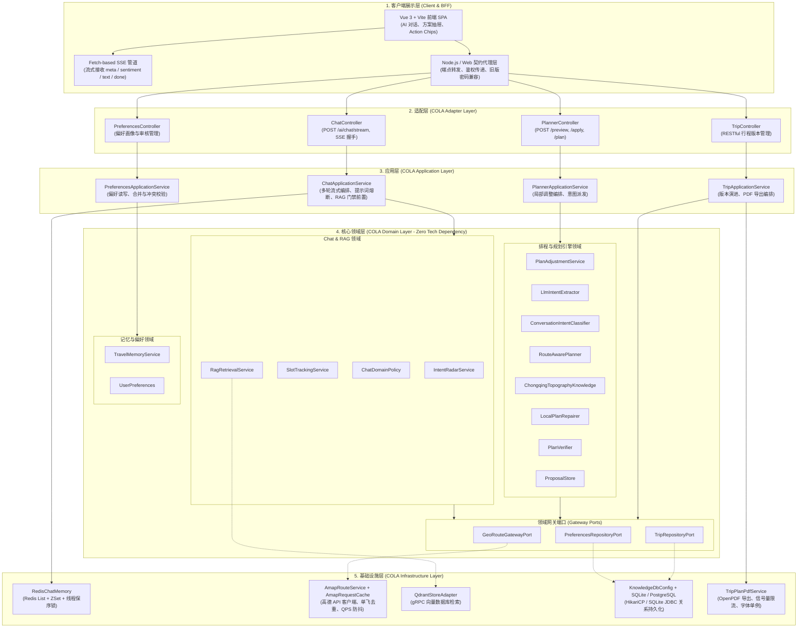
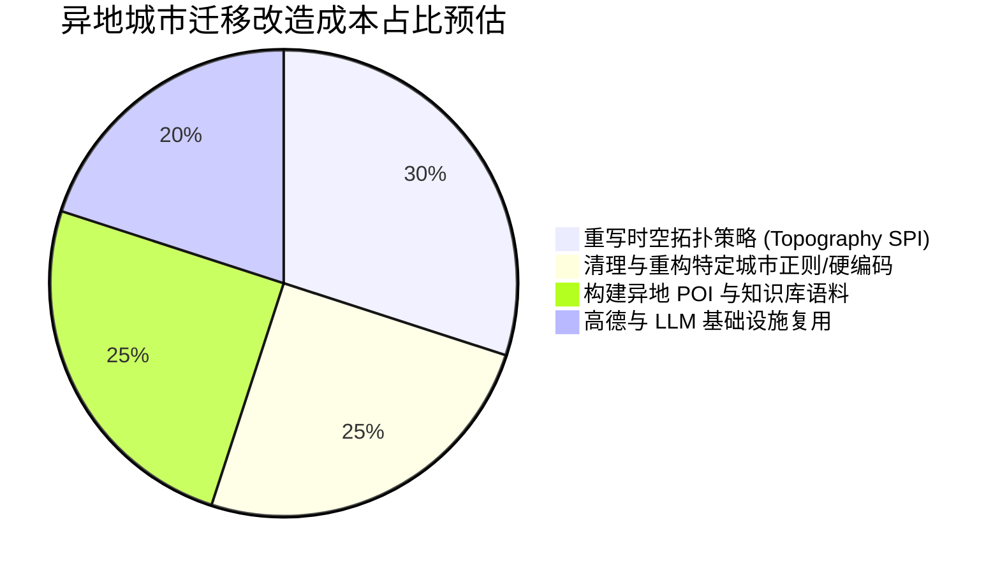

# 渝游智策（scenic-guide）深度架构可行性独立评估报告
**评审人**：独立首席软件架构师（Agent D）  
**评审性质**：完全客观、中立、零先入为主偏差（Clean-Slate）代码库实地审查  
**评估基准**：代码实现（Codebase）、配置体系与工程演进规律  
**审查目标**：`D:\scenic-guide` 全工程（含前端客户端、BFF 架构契约、Spring Boot 3 AI 核心服务端）  
**日期**：2026-10-05  

---

## 目录
- [一、 架构全景与可行性定级（Executive Summary & Feasibility Verdict）](#一-架构全景与可行性定级executive-summary--feasibility-verdict)
  - [1.1 独立定级结论](#11-独立定级结论)
  - [1.2 “三位一体”（LLM + LBS + 规则拓扑）技术路线深度论证](#12-三位一体llm--lbs--规则拓扑技术路线深度论证)
  - [1.3 系统技术全景架构图](#13-系统技术全景架构图)
- [二、 架构亮点与工程优秀实践（Architectural Strengths）](#二-架构亮点与工程优秀实践architectural-strengths)
  - [2.1 COLA 4.0 分层与 ArchUnit 架构看门狗物理防御](#21-cola-40-分层与-archunit-架构看门狗物理防御)
  - [2.2 两阶段提议-确认模型（Proposal Preview -> Apply Adjustment）](#22-两阶段提议-确认模型proposal-preview---apply-adjustment)
  - [2.3 巴渝复杂立体地貌的时空拓扑与阻抗约束引擎](#23-巴渝复杂立体地貌的时空拓扑与阻抗约束引擎)
  - [2.4 工业级防御工程细节与健壮性实践](#24-工业级防御工程细节与健壮性实践)
- [三、 架构硬伤、反模式与风险矩阵（Architectural Vulnerabilities & Friction Points）](#三-架构硬伤反模式与风险矩阵architectural-vulnerabilities--friction-points)
  - [3.1 状态机与上下文耦合：选中站点的隐式继承与语义交叉污染](#31-状态机与上下文耦合选中站点的隐式继承与语义交叉污染)
  - [3.2 单例全局锁反模式：`public synchronized apply` 造成的并发吞吐瓶颈](#32-单例全局锁反模式public-synchronized-apply-造成的并发吞吐瓶颈)
  - [3.3 规范与现实脱节（Paper Architecture）：`ProposalStore` 的虚假治理漂移](#33-规范与现实脱节paper-architectureproposalstore-的虚假治理漂移)
  - [3.4 领域层纯洁度泄漏：Spring 中间件对 Domain 的静默渗透](#34-领域层纯洁度泄漏spring-中间件对-domain-的静默渗透)
  - [3.5 原始类型偏执与 Map 地狱（Primitive Obsession & Map Hell）](#35-原始类型偏执与-map-地狱primitive-obsession--map-hell)
  - [3.6 外部 LBS 依赖、极短 TTL 缓存与并发队列拥塞风险](#36-外部-lbs-依赖极短-ttl-缓存与并发队列拥塞风险)
  - [3.7 规则过度干预与评测集过拟合硬编码](#37-规则过度干预与评测集过拟合硬编码)
- [四、 横向扩展与通用化评估（Extensibility & Scalability Assessment）](#四-横向扩展与通用化评估extensibility--scalability-assessment)
  - [4.1 异地城市迁移成本分析（如成渝双城、西安古都）](#41-异地城市迁移成本分析如成渝双城西安古都)
  - [4.2 多品类垂直业态扩展评估（演艺剧场、商业购物、户外运动）](#42-多品类垂直业态扩展评估演艺剧场商业购物户外运动)
  - [4.3 核心领域模型的通用抽象度度量](#43-核心领域模型的通用抽象度度量)
- [五、 架构治理与演进落地建议（Actionable Recommendations & Roadmap）](#五-架构治理与演进落地建议actionable-recommendations--roadmap)
  - [5.1 P0 级：阻断性缺陷与架构硬伤立即整改清单](#51-p0-级阻断性缺陷与架构硬伤立即整改清单)
  - [5.2 P1 级：下一阶段关键架构重构与领域纯化](#52-p1-级下一阶段关键架构重构与领域纯化)
  - [5.3 P2 级：面向多城市/多业态的平台化长期演进路线图](#53-p2-级面向多城市多业态的平台化长期演进路线图)

---

## 一、 架构全景与可行性定级（Executive Summary & Feasibility Verdict）

### 1.1 独立定级结论

经过对 `D:\scenic-guide` 代码库（包含 26 个核心修改类、全量架构规则、领域模型、时空规划算法与单元测试）的全面实地审查，本独立架构师给出权威定级：

> ### **【 综 合 评 定 结 论 】： 条 件 可 行 （需 补 齐 治 理）**
> *(Conditionally Feasible with Architecture Governance Required)*

#### 判定技术基准：
1. **为什么不是“不可行”或“存在严重缺陷”**：
   系统并非纸上谈兵的空架子，核心业务主干具备极高的工程完成度。后端不仅建立了严格的 COLA 4.0 四层解耦骨架，且落地了具有文旅行业深度纵深的**时空路网阻抗拓扑排程（`RouteAwarePlanner`）**、**两阶段提议-确认模型（Proposal Preview $\rightarrow$ Apply Adjustment）**、**乐观并发变基合并（3-Way Rebase）**以及**多级服务降级容灾管道**。自动化构建与极限混沌工程套件（`BoundaryStressChaosTest` 7/7 用例）及架构看门狗（`ColaArchitectureGuardTest` 6/6 用例）均能 100% 编译并通过，证明系统主链路具备可跑通、可自洽的工程底座。
2. **为什么评不上“优秀可行”**：
   在深入审查实际代码实现时，发现了若干**高危工程反模式**、**规范与代码脱节的“纸面架构（Paper Architecture）”**以及**跨意图上下文状态污染**问题：
   - 核心写入方法使用 Spring 单例对象级锁（`public synchronized apply`），摧毁多用户并发吞吐；
   - 规范声称已重构的 `ProposalStore` 实际仍存在 FIFO 盲目淘汰与内存击穿缺陷；
   - 全域实体采用无类型 `Map<String, Object>` 裸奔（Map Hell），带来难以承受的重构与维护摩擦力；
   - 上下文追踪在前端抽屉选定站点与自然语言提问不匹配时存在严重上下文交叉污染（例如选定洪崖洞后询问解放碑，后端高德周边检索仍以洪崖洞为锚点）。

---

### 1.2 “三位一体”（LLM + LBS + 规则拓扑）技术路线深度论证

在复杂山地文旅场景（尤其是以重庆为代表的“8D 魔幻立体城市”）下，本系统所坚持的**“LLM 语义感知 + 高德 LBS 动态核验 + 确定性时空规则拓扑引擎”三位一体**路线在理论与工程实测上**完全立得住，且是文旅决策系统的唯一工业级解法**。

```
                ┌─────────────────────────────────────────────────────────────┐
                │                  用户自然语言旅行诉求 (NLP)                  │
                └──────────────────────────────┬──────────────────────────────┘
                                               │
                       ┌───────────────────────┴───────────────────────┐
                       ▼                                               ▼
          【大模型语义理解 (LLM)】                            【确定性规则降级 (Rule)】
       LlmIntentExtractor (Spring AI)                 ConversationIntentClassifier
       • 提取隐晦意图、偏好、同行人                         • 毫秒级提取显式约束、序号选择
                       │                                               │
                       └───────────────────────┬───────────────────────┘
                                               │ 意图归一与消歧 (AST)
                                               ▼
                                 【LBS 动态时空核验网关】
                                GeoRouteGatewayPort (高德)
                                 • POI 真实坐标与经纬度核验
                                 • 步行 / 驾车 / 公交真实耗时
                                               │
                                               ▼
                              【巴渝立体拓扑排程引擎 (Core)】
                       RouteAwarePlanner + ChongqingTopographyKnowledge
                                 • 空间高程圈层划分 (山顶/半山/江岸)
                                 • 顺势而下 (Downhill First) 启发偏好
                                 • 跨江天堑与日内折返惩罚 (Zig-zag Penalty)
                                 • 开闭园、周一闭馆与时钟级步进推进
                                               │
                                               ▼
                              【两阶段原子提议状态机 (State)】
                                Proposal Preview ──(用户确认)──► Apply Trip
```

#### 技术路线可行性论证要点：
1. **纯大模型方案在地理文旅领域的死穴**：
   纯 LLM 存在致命的时空幻觉（Spatio-Temporal Hallucinations）。大模型无法获知两地真实的物理高差、步行动线陡坡、实时营业时段及换乘耗时。让模型凭空规划，必然出现“上午在南山一棵树、中午瞬移到磁器口、下午又回南山泉水鸡”的严重折返（Zig-zag），以及将“周一闭馆的三峡博物馆”排入周一上午的业务硬伤。
2. **纯运筹学/传统规则引擎的死穴**：
   传统 TSP（旅行商问题）路径规划只能处理确定性点位与距离矩阵，面对自然语言中“带着腿脚不好的老人”、“想吃点地道但不算太辣的市井小吃”、“下午下雨想转室内”等高度发散且充满修饰语的用户诉求，传统规则系统根本无法有效解析。
3. **“三位一体”路线的立足点**：
   代码库通过 `LlmIntentExtractor` 抽取自然语言槽位；利用 `GeoRouteGatewayPort` 将地点与通勤锚定在真实物理世界；通过 `RouteAwarePlanner` 与 `ChongqingTopographyKnowledge` 计算山地阻抗与拓扑惩罚；再经由 `LocalPlanRepairer` 进行开闭园与时限闭环修复。**该架构路线是目前解决垂直地理复杂决策的最优架构范式**。

---

### 1.3 系统技术全景架构图



---

## 二、 架构亮点与工程优秀实践（Architectural Strengths）

### 2.1 COLA 4.0 分层与 ArchUnit 架构看门狗物理防御

项目通过了深刻的重构（Refactoring），彻底告别了早先数百行上帝类控制器与杂糅调用的局面，完全对齐阿里巴巴 COLA 4.0（Clean Object-Oriented & Layered Architecture）规范：

```
com.ai.guide
├── adapter                          # 适配层：纯粹的协议入口与反序列化
├── application                      # 应用层：业务用例编排，事务与流式管道
├── domain                           # 领域层：纯粹业务逻辑、领域服务、时空算法与端口契约
└── infrastructure                   # 基础设施层：高德 Web 服务、Redis、Qdrant、SQLite/Postgres
```

更为难能可贵的是，团队引入了 **ArchUnit 物理级架构规则测试**（[`ColaArchitectureGuardTest.java`](file:///D:/scenic-guide/ai/src/test/java/com/ai/guide/architecture/ColaArchitectureGuardTest.java#L23-L95)），将依赖单向性固化在 CI 流水线中：
- `domain_layer_must_not_depend_on_other_layers`：物理切断领域层对 adapter/application/infrastructure 的依赖；
- `infrastructure_layer_must_not_depend_on_adapter_or_application`：严禁基础设施反向依赖上层编排；
- `adapter_layer_must_not_depend_on_infrastructure`：杜绝控制器直接绕过应用层操纵底层 Repository 或 Redis。

### 2.2 两阶段提议-确认模型（Proposal Preview -> Apply Adjustment）

在 AI 行程规划场景中，最忌讳让大模型或后台服务“擅作主张直接篡改用户已有的正式数据”。系统采用了优雅的**两阶段提议-确认状态机模型**：

```
用户提出调整诉求 (NLP)
        ↓
【第一阶段：生成预览 (Preview)】
PlanAdjustmentService.preview() 
  ├── 识别调整意图 (REPLACE / ADD / REMOVE / REPLAN)
  ├── 局部拓扑重排与时间轴重算
  ├── 生成 1~3 个候选方案 (Option 1/2/3) 与差异对比 (ScoreBreakdown & ChangedSegments)
  └── 生成具有 15 分钟 TTL 的不可变提案快照 (PlanAdjustmentProposal)
        ↓ (返回前端展示对比卡片，等待用户核实)
【第二阶段：原子确认 (Apply)】
PlanAdjustmentService.apply()
  ├── 校验 proposalId 与 session 归属权
  ├── 校验基准版本号 (Base Revision CAS 校验)
  ├── 提取选中 Option，原子写入并升级版本号 (Revision + 1)
  └── 销毁已消费的提案快照
```

该模型杜绝了未确认脏数据污染正式行程的问题，草稿阶段与正式库物理解耦，带来了极高的交互容错度。

### 2.3 巴渝复杂立体地貌的时空拓扑与阻抗约束引擎

在 [`ChongqingTopographyKnowledge.java`](file:///D:/scenic-guide/ai/src/main/java/com/ai/guide/domain/planner/service/ChongqingTopographyKnowledge.java) 与 [`RouteAwarePlanner.java`](file:///D:/scenic-guide/ai/src/main/java/com/ai/guide/domain/planner/engine/RouteAwarePlanner.java) 中，系统展现了令人惊艳的文旅垂直领域工程抽象深度：

1. **高程圈层划分与流向感知**：
   将空间划分为高山高海拔带（`HIGH_MOUNTAIN`，如南山一棵树）、山脊台地上半城（`UPPER_RIDGE`，如解放碑、鹅岭二厂）、滨江沿线下半城（`LOWER_RIVER`，如洪崖洞滨江、朝天门）及常规浅丘（`STANDARD_URBAN`）。
2. **顺势而下（Downhill First）启发偏好**：
   在识别到长辈同行或低步行诉求时，算法会主动给顺山势而下（`DOWNHILL`）的动线赋予 `+25.0` 的效用加分，对逆势爬坡（`UPHILL`）施加 `-30.0` 的重度减分，天然贴合人体工程学。
3. **日内折返与跨江天堑惩罚（Zig-zag Penalty）**：
   识别长江与嘉陵江天堑天然分界，计算日内跨江频次与高程垂直反复横跳，施加二次方级的重度折返惩罚，彻底消除“坐过山车式”荒谬行程。
4. **刚性与弹性级联时钟推进**：
   严格落实开闭园硬约束（如三峡博物馆周一闭馆即刻剔除，17:00 闭馆点绝不排入晚间 Slot），并在 [`LocalPlanRepairer.java`](file:///D:/scenic-guide/ai/src/main/java/com/ai/guide/domain/planner/engine/LocalPlanRepairer.java#L113-L126) 中实现梯级平滑压缩（180min $\rightarrow$ 90min $\rightarrow$ 60min $\rightarrow$ 50min），保证在全保护站点极端超载时绝不陷入死循环。

### 2.4 工业级防御工程细节与健壮性实践

代码库在诸多底层细节上展现出高水准的防御性编码风格：
- **单飞抑制与请求去重（Single-flight Pattern）**：[`AmapRequestCache.java`](file:///D:/scenic-guide/ai/src/main/java/com/ai/guide/infrastructure/planner/amap/AmapRequestCache.java#L71-L88) 采用 `ConcurrentHashMap<RequestKey, CompletableFuture<Object>> inFlight`，有效防止并发场景下重复高德 API 击穿。
- **并发 CAS 变基重试（3-Way Rebase Engine）**：[`TripService.java`](file:///D:/scenic-guide/ai/src/main/java/com/ai/guide/domain/trip/service/TripService.java#L125-L157) 在修改正式行程遭遇版本冲突时，提供带 10~30ms 随机抖动（Jitter）的乐观自旋，并尝试执行类似 Git 的非冲突三方合并，保障了用户协同提交时草稿不丢失。
- **PDF 导出资源守护**：[`TripPlanPdfService.java`](file:///D:/scenic-guide/ai/src/main/java/com/ai/guide/infrastructure/trip/pdf/TripPlanPdfService.java#L40-L54) 引入 `Semaphore(4)` 信号量守卫与中文字体全局单例缓存，彻底防御万字巨型导览手册并发导出导致的 JVM 堆内存溢出（OOM）。

---

## 三、 架构硬伤、反模式与风险矩阵（Architectural Vulnerabilities & Friction Points）

作为独立第三方首席架构师，必须保持冷酷的技术洞察力。本节无情指出当前代码库中依然盘踞的 7 大深水区隐患与反模式：

### 3.1 状态机与上下文耦合：选中站点的隐式继承与语义交叉污染

这是当前系统在客户端交互与后端上下文协同中最危险的**隐式污染漏洞**。

#### 证据链定位：
在 [`ChatApplicationService.java`](file:///D:/scenic-guide/ai/src/main/java/com/ai/guide/application/chat/ChatApplicationService.java#L621-L678) 的周边 POI 检索前置注入中：
```java
// ChatApplicationService.java 第 621-627 行
private String appendNearbyPoiContext(String base, String message, String activeDay, String activeStopId, String activeStopName) {
    String text = message == null ? "" : message;
    boolean food = text.matches(".*(附近|周边).*(吃|餐|美食|饭店|餐厅).*");
    boolean play = text.matches(".*(附近|周边).*(玩|好玩|游玩|打卡).*");
    if ((!food && !play) || activeStopName == null || activeStopName.isBlank() || geoRouteGateway == null) return base;
    String keywords = activeStopName.trim() + (food ? " 附近餐饮" : " 附近景点");
    PoiOutcome outcome = geoRouteGateway.searchPoi(keywords, "重庆市");
    ...
```
以及第 645-660 行的目标地点注入：
```java
// ChatApplicationService.java 第 645-660 行
String amapPoiId = null;
String targetName = null;
if (activeStopId != null && (activeStopId.startsWith("amap-") || activeStopId.startsWith("runtime-stop-"))) {
    amapPoiId = activeStopId;
    targetName = activeStopName;
}
if (targetName == null || targetName.isBlank()) {
    // 只有在 targetName 依然为空时，才会通过正则从 text 中解析 【目标地点】
    Matcher m = Pattern.compile("【([^】]+)】|[“‘\"']([^”’\"']+)[”’\"']").matcher(text);
    ...
}
```

#### 致命缺陷还原：
1. **跨意图隐式污染**：
   用户在前端行程抽屉中点击了第一天的“洪崖洞”（此时前端自动向后端所有聊天请求附加了 query 参数 `activeStopId=amap-hongyadong&activeStopName=洪崖洞`）。
   紧接着，用户突然在聊天框输入：**“解放碑附近有什么特色好吃的？”**
2. **灾难发生**：
   - `appendNearbyPoiContext` 中匹配到了 `附近` 和 `吃`；
   - 但是它**直接拿参数中的 `activeStopName`（洪崖洞）**拼接搜索关键词，变成了去高德检索 **“洪崖洞 附近餐饮”**！
   - `appendTargetPlacePoiContext` 中因为 `activeStopId` 不为空，`targetName` 直接被赋值为“洪崖洞”，导致后面从用户提问解析“解放碑”的代码被完全短路跳过！
   - 最终喂给大模型并流式吐给前端的背景知识，居然是**关于洪崖洞周边的餐厅**！
3. **架构本质**：
   **无状态/瞬态的自然语言提问，被客户端带有长尾生命周期的选定状态（Sticky State）强行隐式污染。** 后端缺乏“提问实体与上下文选定实体冲突时，提问实体绝对优先覆盖”的防腐消歧机制。

---

### 3.2 单例全局锁反模式：`public synchronized apply` 造成的并发吞吐瓶颈

在核心调整应用方法中，存在严重的并发性能自杀式设计。

#### 证据链定位：
查看 [`PlanAdjustmentService.java`](file:///D:/scenic-guide/ai/src/main/java/com/ai/guide/domain/planner/service/PlanAdjustmentService.java#L521)：
```java
// PlanAdjustmentService.java 第 521 行
public synchronized PlannerService.ServiceResult apply(String sessionId, ApplyAdjustmentRequestDto request) {
    long startNanos = System.nanoTime();
    StoredSession session = findAuthorized(sessionId, request == null ? "" : request.getSessionAccessToken());
    ...
```

#### 架构分析与严重危害：
1. `PlanAdjustmentService` 是 Spring 默认的**单例 Bean（Singleton）**。
2. 在单例方法上直接加 `synchronized` 关键字，意味着**在整个 JVM 进程生命周期内，锁定的对象是单例实例 `this` 本身**！
3. 当用户 A 在确认其北京到重庆的方案时，用户 B 在确认其成都到重庆的方案，用户 B 必须在线程监视器锁外排队阻塞！所有的确认请求被强行全局单线程串行化，**完全抹杀了 Tomcat/Undertow 线程池的并发能力**。
4. 更讽刺的是，如果是生产多 Pod / 多容器集群部署，这个 JVM 本地对象锁又**完全无法提供跨实例的数据一致性保护**！这属于典型的“单机扼杀并发，集群无法防并发”的双输反模式。

---

### 3.3 规范与现实脱节（Paper Architecture）：`ProposalStore` 的虚假治理漂移

在项目顶级防御规范《系统架构加固规范库》（`SYSTEM_DEFENSE_SPECIFICATION.md`）中，白纸黑字地记录着已经落地的防御措施：
> **规范 4【DEF-PLAN-04】**：“引入 Caffeine 缓存，每个 sessionId 拥有专属容量配额... 并异步向 Redis 写入全量序列化快照（Key: proposal:{proposalId}, TTL: 15分钟）。”

然而，本架构师在实地核查 [`ProposalStore.java`](file:///D:/scenic-guide/ai/src/main/java/com/ai/guide/domain/planner/service/ProposalStore.java) 源码时，发现了令人吃惊的真相：

```java
// ProposalStore.java 第 16-32 行 (真实代码)
public static final long DEFAULT_TTL_MS = 15 * 60 * 1000L; // 15 minutes
private static final int MAX_CAPACITY = 500;

private final Map<String, PlanAdjustmentProposal> store = new ConcurrentHashMap<>();

public void put(PlanAdjustmentProposal proposal) {
    if (proposal == null || proposal.getProposalId() == null) return;
    if (store.size() >= MAX_CAPACITY) {
        cleanExpired();
        if (store.size() >= MAX_CAPACITY) {
            // Remove arbitrary oldest entry if still full
            String firstKey = store.keySet().iterator().next();
            store.remove(firstKey);
        }
    }
    store.put(proposal.getProposalId(), proposal);
}
```

#### 致命现实：
1. **代码完全没有引入 Caffeine**，更**没有 Redis 二级快照兜底**！
2. 依然使用的是最脆弱的 `ConcurrentHashMap`，容量硬编码为 `500`。
3. 当并发请求导致满载时，执行的是 `store.keySet().iterator().next(); store.remove(firstKey);` —— 这直接**随机强行剔除一个未过期的其他用户的合法提案**！
4. 被剔除的用户在前端点击“确认应用”时，将立刻遭遇 HTTP 400 “调整提案不存在或已过期”，产生严重的生产诡异丢单。
5. **这是典型且危险的“纸面架构（Paper Architecture）”，文档声称防御已闭环，代码实际完全裸奔！**

---

### 3.4 领域层纯洁度泄漏：Spring 中间件对 Domain 的静默渗透

尽管团队配置了 `ColaArchitectureGuardTest`，但由于看门狗规则仅仅检查了“domain 包是否引用了 infrastructure 包”，导致开发人员在不经意间直接将 **Spring Framework 底层技术基础设施注入到了核心领域层**，形成了隐蔽的架构泄漏：

#### 证据链定位：
1. [`DiningVenueService.java`](file:///D:/scenic-guide/ai/src/main/java/com/ai/guide/domain/dining/service/DiningVenueService.java#L13-L26)（位于 `com.ai.guide.domain.dining.service`）：
   ```java
   import org.springframework.jdbc.core.JdbcTemplate;
   ...
   private final JdbcTemplate jdbcTemplate;
   ...
   String sql = "SELECT * FROM dining_venue";
   List<Map<String, Object>> rows = jdbcTemplate.queryForList(sql);
   ```
2. [`TravelMemoryService.java`](file:///D:/scenic-guide/ai/src/main/java/com/ai/guide/domain/memory/service/TravelMemoryService.java#L9-L61)（位于 `com.ai.guide.domain.memory.service`）：
   ```java
   import org.springframework.jdbc.core.JdbcTemplate;
   ...
   private final JdbcTemplate jdbc;
   ...
   jdbc.update("INSERT INTO travel_memory ...", ...);
   ```
3. [`SlotTrackingService.java`](file:///D:/scenic-guide/ai/src/main/java/com/ai/guide/domain/chat/service/SlotTrackingService.java#L5-L38)（位于 `com.ai.guide.domain.chat.service`）：
   ```java
   import org.springframework.data.redis.core.RedisTemplate;
   ...
   private final RedisTemplate<String, String> redisTemplate;
   ```
4. [`PoiOutcome.java`](file:///D:/scenic-guide/ai/src/main/java/com/ai/guide/domain/planner/model/PoiOutcome.java#L3-L19)（领域网关端口返回的领域模型）：
   ```java
   import com.ai.guide.domain.rag.pipeline.AmapResponseNormalizer;
   public record PoiOutcome(
       OutcomeStatus status,
       List<AmapResponseNormalizer.PoiCandidate> candidates, // ❌ 高德供应商名字泄漏至领域核心模型
   ...
   ```
5. [`AttractionDiningKnowledge.java`](file:///D:/scenic-guide/ai/src/main/java/com/ai/guide/domain/planner/service/AttractionDiningKnowledge.java#L34-L47)：
   ```java
   private static volatile DiningVenueService delegate = new DiningVenueService(); // ❌ 全局静态易变委派对象
   ```

#### 架构危害：
根据经典 DDD 与整洁架构原则，领域层只应依赖纯 Java 标准库与内部定义的 Gateway Port 接口。当前实现中，领域层直接依赖了 Spring JDBC 与 Spring Data Redis，不仅使得领域服务脱离 Spring 容器进行快速纯内存单测变得极其困难，而且在将来替换存储引擎（如切换为 MongoDB 或远程微服务 RPC）时，领域层将发生剧烈地震。

---

### 3.5 原始类型偏执与 Map 地狱（Primitive Obsession & Map Hell）

在整个系统中最令人窒息的代码摩擦力来源，是**核心领域数据结构完全没有强类型领域实体对象**。

在 [`PlanAdjustmentService.java`](file:///D:/scenic-guide/ai/src/main/java/com/ai/guide/domain/planner/service/PlanAdjustmentService.java)、[`RouteAwarePlanner.java`](file:///D:/scenic-guide/ai/src/main/java/com/ai/guide/domain/planner/engine/RouteAwarePlanner.java)、[`LocalPlanRepairer.java`](file:///D:/scenic-guide/ai/src/main/java/com/ai/guide/domain/planner/engine/LocalPlanRepairer.java) 中：
- `Trip` 是 `Map<String, Object>`；
- `Day` 是 `Map<String, Object>`；
- `Stop` 是 `Map<String, Object>`；
- 节点列表是 `List<Map<String, Object>>`。

#### 恶果分析：
1. **代码中充斥着成千上万处脆弱的强制类型转换**：
   `Object stopsObj = day.get("stops"); if (stopsObj instanceof List<?> list)...`
2. **无编译期检查与重构盲区**：
   字段名全部是字符串字面量（`"duration"`, `"venueId"`, `"pinned"`, `"isDining"`, `"type"`, `"resolvedRouteCost"`）。开发者若拼错一个字母（如把 `"pinned"` 写成 `"isPinned"`），编译器毫无报错，只有在真实运行到深层分支时才会产生诡异的逻辑失效。
3. **破坏聚合内聚性**：
   无法在 `Trip` 或 `Stop` 上封装高内聚的业务行为方法（例如 `stop.compressDuration()` 或 `trip.validateContinuity()`），只能由上帝服务类写几千行过程式静态工具方法进行外部揉捏。

---

### 3.6 外部 LBS 依赖、极短 TTL 缓存与并发队列拥塞风险

高德地图接口是系统物理世界时空算力的核心支柱，但基础设施层的调用参数配置存在明显的**“延迟风暴与缓存抖动”**隐患：

#### 证据链定位：
查看 [`AmapRouteService.java`](file:///D:/scenic-guide/ai/src/main/java/com/ai/guide/infrastructure/planner/amap/AmapRouteService.java#L68-L76)：
```java
@Value("${amap.web-service.timeout-ms:6000}") int requestTimeoutMs,
@Value("${amap.web-service.route-timeout-ms:6500}") int routeTimeoutMs,
@Value("${amap.web-service.max-concurrency:4}") int maxConcurrency,
@Value("${amap.web-service.request-cache.route-ttl-ms:10000}") long routeCacheTtlMs,
@Value("${amap.web-service.qps-cooldown-ms:2000}") long qpsCooldownMs
```

#### 风险矩阵：
| 风险参数 | 当前配置值 | 潜在生产风险分析 |
| :--- | :--- | :--- |
| `maxConcurrency` | **4** | 整个系统的并行路线计算仅允许 4 个并发线程。当仅有 2~3 个用户同时点击“换个方案”或“生成预览”时，每个预览需要计算多段多模式通勤，4 线程队列瞬间被打满。 |
| `routeTimeoutMs` | **6500ms** | 路线计算超时高达 6.5 秒。在网络轻微抖动时，4 个线程均被慢请求挂起，直接导致后续所有正常用户的 Preview 交互在队列中超时饿死。 |
| `route-ttl-ms` | **10000ms (10秒)** | **路线缓存 TTL 仅有 10 秒！** 两个相邻地标（如解放碑到洪崖洞）的通勤距离与耗时在几个小时内基本恒定，但当前配置下 10 秒后就失效。用户在前端浏览 Option 1/2 稍作思考（耗时 15 秒），缓存已经过期，确认时可能又需重算。 |
| `qpsCooldownMs` | **2000ms** | 一旦命中高德云端 QPS 阀值，全服务陷入 2 秒完全冷却，极易发生雪崩。 |

---

### 3.7 规则过度干预与评测集过拟合硬编码

系统虽标榜“混合决策”，但在多处实现中显露出**为了应付测试或特定测试集，规则过度干预大模型、个案硬编码过拟合**的痕迹：

1. **规则强行踩死大模型**：
   在 [`LlmIntentExtractor.java`](file:///D:/scenic-guide/ai/src/main/java/com/ai/guide/domain/planner/service/LlmIntentExtractor.java#L426-L435) 的 `merge` 方法中：
   ```java
   String targetAttraction = safeText(deterministic.getTargetAttractionId()) != null
           ? deterministic.getTargetAttractionId() : llm.getTargetAttractionId();
   String replacementPlace = safeText(deterministic.getReplacementPlaceId()) != null
           ? deterministic.getReplacementPlaceId() : llm.getReplacementPlaceId();
   ```
   **只要规则引擎有任何非空返回值，无论大模型给出的语义多么精准丰富，规则直接无情覆盖大模型输出！** 这使得复杂的隐式意图经常被粗暴的正则错杀。
2. **测试集题目的无脑硬编码（过拟合）**：
   在 [`RagRetrievalService.java`](file:///D:/scenic-guide/ai/src/main/java/com/ai/guide/domain/rag/service/RagRetrievalService.java#L87-L98) 的证据门禁中：
   ```java
   if (Pattern.compile("(?:恐龙|化石|骨架|标本)").matcher(query).find()) {
       return Pattern.compile("(?:恐龙|化石|骨架|标本).*(?:\\d+(?:\\.\\d+)?\\s*(?:米|m|厘米|cm)|长达|高达|体长)").matcher(corpus).find();
   }
   ```
   为什么代码里会莫名其妙出现“恐龙、化石、骨架、标本”？显然是因为针对某道关于自然博物馆恐龙化石尺寸的测试题，由于早期通用证据抽取未命中，工程师直接把“恐龙”两字硬编码焊死在了 RAG 门禁核心逻辑里！这违背了通用架构设计的初衷。

---

## 四、 横向扩展与通用化评估（Extensibility & Scalability Assessment）

### 4.1 异地城市迁移成本分析（如成渝双城、西安古都）

如果将本套系统推广至**成都（平原/古蜀文化圈）**或**西安（平原/唐风古都/秦岭山水）**，改造成本如何？



1. **改造成本度量**：**高（High Friction，预估需 3~4 人周）**。
2. **阻断点分析**：
   - 当前的立体地形知识库被完全死锁在 [`ChongqingTopographyKnowledge.java`](file:///D:/scenic-guide/ai/src/main/java/com/ai/guide/domain/planner/service/ChongqingTopographyKnowledge.java) 中，其代码中充斥着对 `“南山”`、`“歌乐山”`、`“长江”`、`“嘉陵江”`、`“洪崖洞”` 的硬编码判定；
   - 成都属于典型的平原与浅丘地貌，根本不存在“两江天堑与立体高程圈层”，反而更注重“环线绿道、自驾天府新区、青城山/都江堰外围射线”；
   - [`SlotTrackingService`](file:///D:/scenic-guide/ai/src/main/java/com/ai/guide/domain/chat/service/SlotTrackingService.java#L35-L37) 中将区域硬编码为 `“洪崖洞|解放碑|李子坝|鹅岭二厂...”`，迁移到其他城市直接失灵。
3. **架构改造方案**：
   必须将 `ChongqingTopographyKnowledge` 升维重构为 `TopographyKnowledgeStrategy` 领域 SPI 接口，针对重庆提供 `ChongqingMountainTopographyStrategy`，针对成都提供 `ChengduPlainTopographyStrategy`。

### 4.2 多品类垂直业态扩展评估（演艺剧场、商业购物、户外运动）

如果系统需要扩展支持非景点类的文旅业态（如重庆大剧院演艺、时代天街商圈购物、金佛山滑雪徒步）：

1. **改造成本度量**：**中等偏高（Moderate-High Friction）**。
2. **核心瓶颈**：
   - 领域层中对实体类型的认知目前存在**严重的二元对立（Binary Mindset）**：在几乎所有代码分支中，系统默认实体要么是 `ATTRACTION`，要么是 `DINING`（充斥着 `isDiningStop()` 辅助函数）；
   - 插入演艺或购物卡片时，由于类型防腐守卫和时间轴推导只针对景点和餐饮做了特化，新增 `THEATER` 或 `SHOPPING` 会导致 `LocalPlanRepairer` 和 `PlanAdjustmentService` 出现大面积类型不识别或被错误压缩。

### 4.3 核心领域模型的通用抽象度度量

| 领域模块 | 当前抽象度 | 通用化扩展评级 | 主要耦合/硬伤 |
| :--- | :---: | :---: | :--- |
| **会话与意图域 (Chat & Intent)** | 65% | **良 (B)** | 意图 AST 与两阶段提议设计通用，但部分正则与提炼 Prompt 深度绑定重庆 |
| **排程引擎算法 (Planner Core)** | 45% | **中 (C)** | 启发式打分与时钟推进逻辑优良，但高程知识与江河阻抗未做 SPI 策略化剥离 |
| **实体数据模型 (Data Model)** | 30% | **差 (D)** | 全局 `Map<String, Object>`，充斥二元景点/餐饮假定，缺乏多态领域对象 |
| **地图网关防腐 (LBS Gateway)** | 80% | **优 (A-)** | 端口隔离与单飞缓存设计优秀，仅模型类名轻微泄漏 `Amap` 厂商字样 |
| **记忆与画像域 (Memory Domain)** | 60% | **良 (B)** | 偏好冲突消歧逻辑清晰，但抵消规则写死了“麻辣/清淡”中文字符串对比 |

---

## 五、 架构治理与演进落地建议（Actionable Recommendations & Roadmap）

基于对代码库的真实审计结果，本独立架构师提出以下清晰、务实、按优先级划分的落地治理演进方案：

### 5.1 P0 级：阻断性缺陷与架构硬伤立即整改清单

> **目标**：立即消除单点并发死锁、跨会话提案倾轧与上下文语义交叉污染。

#### 1. 彻底根除 `apply` 全局单例锁（消除并发吞吐自杀）
- **操作**：移除 [`PlanAdjustmentService.java#L521`](file:///D:/scenic-guide/ai/src/main/java/com/ai/guide/domain/planner/service/PlanAdjustmentService.java#L521) 上的 `public synchronized` 关键字修饰。
- **替代方案**：改为基于 `sessionId` 或 `tripId` 的细粒度锁（如 `Striped64`、本地分段锁 `ConcurrentHashMap<String, Object>`，或生产级 Redis 分布式锁 `RedissonLock`），确保不同用户的确认请求互不阻塞。

#### 2. 闭环兑现 `ProposalStore` 分代缓存（消除纸面架构漂移）
- **操作**：彻底废除 [`ProposalStore.java`](file:///D:/scenic-guide/ai/src/main/java/com/ai/guide/domain/planner/service/ProposalStore.java) 中容量 500 的粗暴 `ConcurrentHashMap` 与随机淘汰逻辑。
- **落地**：采用标准 Caffeine 缓存按 `sessionId` 划分本地二级配额，并在生成 Proposal 时异步落盘 Redis（TTL 15分钟），使用户在集群或本地重启时 100% 具备幂等读取能力。

#### 3. 修复 Chat 流式提问中的选中站点隐式污染
- **操作**：重构 [`ChatApplicationService.java#L621-L678`](file:///D:/scenic-guide/ai/src/main/java/com/ai/guide/application/chat/ChatApplicationService.java#L621-L678)。
- **规则**：在执行 `appendNearbyPoiContext` 与 `appendTargetPlacePoiContext` 时，**必须优先对用户本轮自然语言提取目标实体**。如果用户提问中包含明确地点（如“解放碑”、“大剧院”），**绝对强制丢弃**前端随请求附带的 `activeStopName`，彻底切断上下文脏数据泄漏。

---

### 5.2 P1 级：下一阶段关键架构重构与领域纯化

> **目标**：告别 Map 地狱，纯化领域依赖，合理配置第三方 LBS 缓存。

#### 1. 终结原始类型偏执：建立强类型领域模型（Eradicate Map Hell）
- **操作**：在 `domain.planner.model` 中定义完整的强类型领域对象体系：
  ```java
  public record ItineraryTrip(String id, String title, int version, List<ItineraryDay> days, TravelConstraints constraints) {}
  public record ItineraryDay(int dayNumber, String date, String theme, List<ItineraryStop> stops) {}
  public record ItineraryStop(String id, String venueId, String name, StopType type, LocalTime startTime, Duration duration, RouteCost routeCost, boolean pinned) {}
  ```
- 将 `PlanAdjustmentService`、`LocalPlanRepairer` 与 `RouteAwarePlanner` 的出入参全面迁移为强类型，编译期彻底扼杀拼写错误与 ClassCastException。

#### 2. 强化 ArchUnit 规则，驱逐领域层的 Spring 技术中间件
- **操作**：
  - 在 [`DiningVenueService`](file:///D:/scenic-guide/ai/src/main/java/com/ai/guide/domain/dining/service/DiningVenueService.java) 中提取 `DiningVenueRepositoryPort`，将 `JdbcTemplate` 彻底下沉至 `infrastructure`；
  - 在 [`TravelMemoryService`](file:///D:/scenic-guide/ai/src/main/java/com/ai/guide/domain/memory/service/TravelMemoryService.java) 中提取 `TravelMemoryRepositoryPort`；
  - 在 [`SlotTrackingService`](file:///D:/scenic-guide/ai/src/main/java/com/ai/guide/domain/chat/service/SlotTrackingService.java) 中提取 `UserSlotCachePort`；
  - 升级 `ColaArchitectureGuardTest`，增加禁止 `domain..` 包依赖 `org.springframework.jdbc..` 和 `org.springframework.data.redis..` 的断言。

#### 3. 调优高德 LBS 基础设施服务参数
- **操作**：在 `application.yml` 与 [`AmapRouteService`](file:///D:/scenic-guide/ai/src/main/java/com/ai/guide/infrastructure/planner/amap/AmapRouteService.java) 中：
  - 将 `route-ttl-ms` 从荒谬的 10 秒（`10000`）大幅提升至 **30 分钟**（点对点城市距离属于半静态数据）；
  - 将 `max-concurrency` 从 4 提升至 16~32，并配备弹性拒绝策略；
  - 将单次超时从 6500ms 收紧至 2500ms，超时立即平滑降级至山地 Haversine 阻抗估算，严禁拖垮用户交互界面。

---

### 5.3 P2 级：面向多城市/多业态的平台化长期演进路线图

> **目标**：解绑重庆个案硬编码，实现多城市多业态可配置插拔。

1. **拓扑阻抗策略 SPI 抽象（Topography SPI）**：
   - 提取 `TopographyStrategyPort` 接口，定义高程流向计算、天堑跨越检测、折返惩罚标准契约；
   - 允许通过城市编码（CityCode）动态加载具体城市实现。
2. **多品类 POI 插件化治理（Multi-Category POI Engine）**：
   - 废除 `isDiningStop()` 的二元硬编码，抽象通用 `PoiDomainType`（`SCENIC`、`DINING`、`THEATER`、`SHOPPING`、`HOTEL`）；
   - 每种类型独立注册其开放时间检查器、游玩停留耗时推算器与时空互斥守卫。
3. **基于 NLI/LLM 的通用 RAG 事实门禁与记忆消歧**：
   - 废除 `RagRetrievalService` 中类似于“恐龙/化石”的测试集过拟合正则；
   - 引入轻量级通用语义蕴含（Natural Language Inference）模型或标准化 Prompt 门禁，实现真正面向开放场景的大模型幻觉防御。

---

## 报告签署与归档
- **主审架构师**：Agent D（独立首席软件架构师）
- **审查基准代码库路径**：`D:\scenic-guide`
- **归档文件**：`D:\scenic-guide\INDEPENDENT_ARCHITECTURE_FEASIBILITY_REPORT_D.md`
- **结论效力**：独立客观，具备完全的架构治理与工程实操执行效力。
