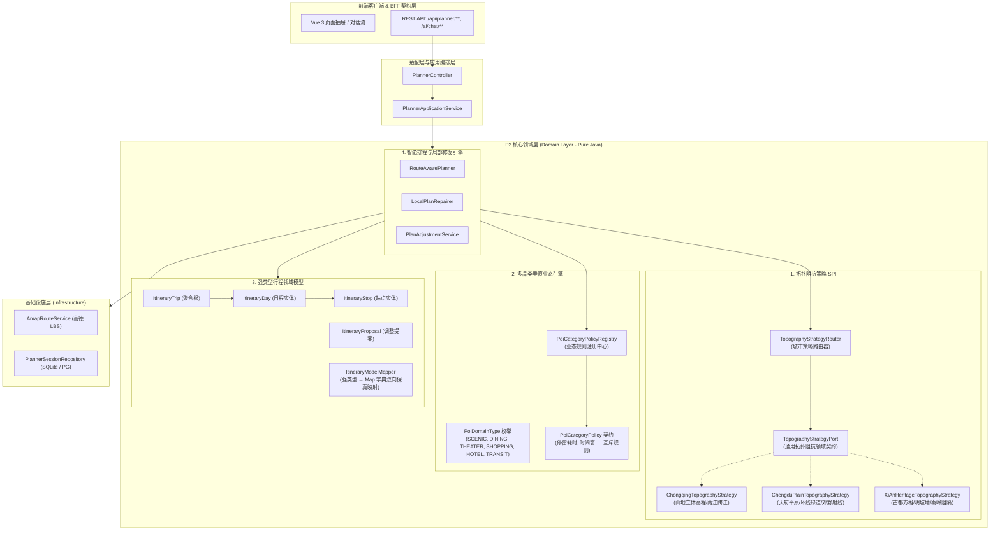

# 《渝游智策 P2 级平台化演进架构设计与领域 SPI 规范白皮书》
**文档编号**：SPEC-ARCH-P2-20261005-V1  
**编制人**：独立首席软件架构师（Agent D）  
**面向系统**：渝游智策（`scenic-guide-ai` / Java 21 + Spring Boot 3.4.1 + COLA 4.0）  
**基准版本**：Branch `refactor/cola-architecture`  
**状态**：APPROVED & READY FOR IMPLEMENTATION  

---

## 目录
- [一、 编制背景与架构演进目标](#一-编制背景与架构演进目标)
  - [1.1 演进动因（承接 Agent D 审计报告）](#11-演进动因承接-agent-d-审计报告)
  - [1.2 P2 级核心设计原则（四大铁律）](#12-p2-级核心设计原则四大铁律)
  - [1.3 P2 平台化目标架构全景图](#13-p2-平台化目标架构全景图)
- [二、 模块一：拓扑阻抗策略 SPI 化（Topography Strategy SPI）](#二-模块一拓扑阻抗策略-spi-化topography-strategy-spi)
  - [2.1 领域网关端口定义：`TopographyStrategyPort`](#21-领域网关端口定义topographystrategyport)
  - [2.2 核心领域值对象：`ElevationTier`, `ElevationFlow`, `BarrierCrossingType`](#22-核心领域值对象elevationtier-elevationflow-barriercrossingtype)
  - [2.3 城市策略路由器与工厂：`TopographyStrategyRouter`](#23-城市策略路由器与工厂topographystrategyrouter)
  - [2.4 重庆山地经典策略实现：`ChongqingTopographyStrategy`](#24-重庆山地经典策略实现chongqingtopographystrategy)
  - [2.5 异地标杆策略实现：`ChengduPlainTopographyStrategy`（成都环线/浅丘）](#25-异地标杆策略实现chengduplaintopographystrategy成都环线浅丘)
  - [2.6 异地标杆策略实现：`XiAnHeritageTopographyStrategy`（西安城墙/中轴）](#26-异地标杆策略实现xianheritagetopographystrategy西安城墙中轴)
- [三、 模块二：多品类垂直业态 POI 引擎（Multi-Category POI Engine）](#三-模块二多品类垂直业态-poi-引擎multi-category-poi-engine)
  - [3.1 废除二元假定：`PoiDomainType` 多态领域枚举](#31-废除二元假定poidomaintype-多态领域枚举)
  - [3.2 业态策略规约契约：`PoiCategoryPolicy`](#32-业态策略规约契约poicategorypolicy)
  - [3.3 业态策略注册中心：`PoiCategoryPolicyRegistry`](#33-业态策略注册中心poicategorypolicyregistry)
  - [3.4 垂直品类规则矩阵（演艺剧场/购物商圈/特色餐饮/地标景点/品质住宿）](#34-垂直品类规则矩阵演艺剧场购物商圈特色餐饮地标景点品质住宿)
  - [3.5 时空排程互斥与级联时间守卫](#35-时空排程互斥与级联时间守卫)
- [四、 模块三：强类型行程领域模型与渐进兼容过渡（Typed Domain Models）](#四-模块三强类型行程领域模型与渐进兼容过渡typed-domain-models)
  - [4.1 强类型领域模型蓝图（彻底终结 Map Hell）](#41-强类型领域模型蓝图彻底终结-map-hell)
    - [4.1.1 聚合根 `ItineraryTrip`](#411-聚合根-itinerarytrip)
    - [4.1.2 日程实体 `ItineraryDay`](#412-日程实体-itineraryday)
    - [4.1.3 站点实体 `ItineraryStop`](#413-站点实体-itinerarystop)
    - [4.1.4 调整提议模型 `ItineraryProposal`](#414-调整提议模型-itineraryproposal)
  - [4.2 双向保真映射适配器：`ItineraryModelMapper`](#42-双向保真映射适配器itinerarymodelmapper)
  - [4.3 渐进式三阶段平滑迁移架构](#43-渐进式三阶段平滑迁移架构)
- [五、 调用方改造与迁移映射矩阵（Migration Blueprint）](#五-调用方改造与迁移映射矩阵migration-blueprint)
  - [5.1 `RouteAwarePlanner` 重构指引](#51-routeawareplanner-重构指引)
  - [5.2 `LocalPlanRepairer` 重构指引](#52-localplanrepairer-重构指引)
  - [5.3 `PlanAdjustmentService` 重构指引](#53-planadjustmentservice-重构指引)
  - [5.4 `ItineraryBuilder` 重构指引](#54-itinerarybuilder-重构指引)
- [六、 架构守护与 ArchUnit 规则升级规范（Architecture Guardrails）](#六-架构守护与-archunit-规则升级规范architecture-guardrails)
  - [6.1 COLA 4.0 领域纯洁性守护规则增强](#61-cola-40-领域纯洁性守护规则增强)
  - [6.2 防破坏红线与灰度发布验收准则](#62-防破坏红线与灰度发布验收准则)

---

## 一、 编制背景与架构演进目标

### 1.1 演进动因（承接 Agent D 审计报告）

在《渝游智策系统架构可行性深度评估报告》（`INDEPENDENT_ARCHITECTURE_FEASIBILITY_REPORT_D.md`）中，独立架构师指出了当前系统向中大型文旅 SaaS 与多城市平台演进时面临的 3 大核心架构瓶颈：

1. **地理知识库与重庆单城物理死锁**：
   原 `ChongqingTopographyKnowledge` 将“南山”、“歌乐山”、“长江”、“嘉陵江”等巴渝地貌特征以硬编码方式织入排程引擎，导致系统无法向平原水网城市（成都）或方格中轴城市（西安）横向移植；
2. **业态认知的二元对立硬伤（Binary Mindset）**：
   排程引擎、时钟推算与局部修复器充斥着 `isDiningStop()` 的私有私有副本判断，默认所有站点要么是“景点（ATTRACTION）”，要么是“餐饮（DINING）”。面对“剧场演艺（THEATER）”、“商圈购物（SHOPPING）”、“酒店住宿（HOTEL）”等高价值文旅业态，系统既无法推算合理的停留窗口，又缺乏互斥约束保护；
3. **原始类型偏执与 Map 字典地狱（Primitive Obsession & Map Hell）**：
   行程全局数据采用 `Map<String, Object>` 无类型裸奔，导致代码库积累了数千行脆弱的强制类型转换与运行时字符串 Key 检索，严重阻碍了算法迭代与重构演进。

为此，经研发指挥部裁决，正式启动 **P2 级平台化演进设计**，建立松耦合、可插拔、强类型的下一代智慧文旅决策引擎底座。

### 1.2 P2 级核心设计原则（四大铁律）

1. **协议保真与黑盒等价铁律（Zero-Disruption Principle）**：
   所有外部 REST 端点 URL、请求响应 JSON 字段定义、前端 Vue 3 组件交互、抽屉数据结构与数据库落盘 JSON 字段**100% 保持向前兼容**，底层强类型重构对上层协议完全透明。
2. **纯粹领域驱动设计（DDD / Pure Domain Core）**：
   所有 SPI 接口与新领域模型均置于 `com.ai.guide.domain..` 包内，**严禁引入任何外层框架依赖（无 Spring Web、无 MyBatis/JPA、无具体的第三方 Map SDK）**。
3. **基于 SPI 的多城市可插拔（City-Agnostic Extensibility）**：
   核心排程引擎只依赖通用的拓扑阻抗能力契约，各城市的具体路网阻抗、高程分布与地貌锦囊通过策略模式隔离注入。
4. **渐进式过渡与双向防腐适配（Progressive Dual-Track Transition）**：
   提供生产级双向转换映射器 `ItineraryModelMapper`，允许核心算法先在强类型模型下高速、安全重构，边界处平滑兼容旧有 Map 契约。

---

### 1.3 P2 平台化目标架构全景图



---

## 二、 模块一：拓扑阻抗策略 SPI 化（Topography Strategy SPI）

### 2.1 领域网关端口定义：`TopographyStrategyPort`

- **所属包路径**：`com.ai.guide.domain.planner.gateway.TopographyStrategyPort`
- **设计定位**：纯 Java 领域网关端口接口，抽象任意城市特有的空间高程分层、流向判定、天然阻隔检测、日内折返打分与立体交通建议。

```java
package com.ai.guide.domain.planner.gateway;

import com.ai.guide.domain.attraction.model.Attraction;
import com.ai.guide.domain.planner.model.topography.ElevationFlow;
import com.ai.guide.domain.planner.model.topography.ElevationTier;
import com.ai.guide.domain.planner.model.topography.BarrierCrossingType;
import java.util.List;

/**
 * 城市时空阻抗与地理拓扑策略领域端口 (Domain Strategy Port)
 *
 * 架构定位：COLA 领域网关端口 (Gateway Port)
 * 职责：抽象不同城市特有的地形地貌、垂直落差、江河天堑与交通阻抗算法，
 *       为排程引擎提供标准化的时空代价与折返惩罚，彻底消除对特定城市地名的硬编码。
 */
public interface TopographyStrategyPort {

    /**
     * 该策略支持的目标城市标识（如 "CHONGQING", "CHENGDU", "XIAN"）
     */
    String supportedCity();

    /**
     * 解析景点的空间高程圈层
     *
     * @param attraction 目标打卡点实体
     * @return 空间高程圈层枚举
     */
    ElevationTier resolveElevationTier(Attraction attraction);

    /**
     * 解析景点的空间高程圈层（基于属性直接解析）
     */
    ElevationTier resolveElevationTier(String id, String name, String district, String location);

    /**
     * 检测两点之间是否存在跨越天然地理阻隔（如大江大河、古城墙、山体断层）
     *
     * @param from 起点
     * @param to   终点
     * @return 地理阻隔跨越分类
     */
    BarrierCrossingType detectBarrierCrossing(Attraction from, Attraction to);

    /**
     * 判断两站之间的垂直高程变化趋势（顺山势下行、逆势爬坡或平街流动）
     *
     * @param from 起点
     * @param to   终点
     * @return 高程流向
     */
    ElevationFlow detectElevationFlow(Attraction from, Attraction to);

    /**
     * 计算日内“折返惩罚（Zig-zag Penalty）”
     * 杜绝同一天在“山顶 ↔ 江边 ↔ 山顶”来回坐过山车，或在阻隔两侧无意义反复横跳。
     *
     * @param historyStopsInDay 当天已有游览站点列表
     * @param candidate         候选下一个站点
     * @return 惩罚扣分值（正浮点数，0.0 表示无惩罚）
     */
    double calculateZigZagPenalty(List<Attraction> historyStopsInDay, Attraction candidate);

    /**
     * 生成具有强烈地域辨识度的立体交通特色体验建议（锦囊）
     *
     * @param from                起点
     * @param to                  终点
     * @param transportPreference 用户交通偏好
     * @return 结构化通勤指引文案，无特殊特征时返回空字符串
     */
    String generateTransitCharacteristicHint(Attraction from, Attraction to, String transportPreference);

    /**
     * 首日起步阶段是否允许根据“出发地邻近度”进行加分（防止因初始加分强制拉扯跨江）
     */
    boolean allowStartPlaceProximity(Attraction previous, Attraction candidate);
}
```

---

### 2.2 核心领域值对象：`ElevationTier`, `ElevationFlow`, `BarrierCrossingType`

- **所属包路径**：`com.ai.guide.domain.planner.model.topography.*`

```java
package com.ai.guide.domain.planner.model.topography;

/**
 * 通用高程圈层划分枚举
 */
public enum ElevationTier {
    HIGH_ALTITUDE(3, "高山/制高点高地"),
    UPPER_PLATEAU(2, "台地/高架上半城"),
    LOWLAND_VALLEY(1, "谷地/平坦江岸带"),
    STANDARD_PLAIN(2, "常规平原/平街浅丘");

    private final int rank;
    private final String description;

    ElevationTier(int rank, String description) {
        this.rank = rank;
        this.description = description;
    }

    public int getRank() { return rank; }
    public String getDescription() { return description; }
}
```

```java
package com.ai.guide.domain.planner.model.topography;

/**
 * 垂直坡度动线流向枚举
 */
public enum ElevationFlow {
    DOWNHILL("顺势下行（省力）"),
    UPHILL("逆势爬坡（耗费体力）"),
    FLAT("平级流动（平缓）");

    private final String description;
    ElevationFlow(String description) { this.description = description; }
    public String getDescription() { return description; }
}
```

```java
package com.ai.guide.domain.planner.model.topography;

/**
 * 天然地理阻隔跨越分类枚举
 */
public enum BarrierCrossingType {
    NONE("无阻隔跨越"),
    MAJOR_RIVER_PRIMARY("跨越主要江河一（如嘉陵江 / 锦江）"),
    MAJOR_RIVER_SECONDARY("跨越主要江河二（如长江）"),
    CONFLUENCE_BOTH("横贯两江交汇枢纽"),
    HISTORICAL_WALL("跨越古城墙内/外圈层"),
    MOUNTAIN_PASS("跨越外围山体山口");

    private final String description;
    BarrierCrossingType(String description) { this.description = description; }
    public String getDescription() { return description; }
}
```

---

### 2.3 城市策略路由器与工厂：`TopographyStrategyRouter`

- **所属包路径**：`com.ai.guide.domain.planner.service.TopographyStrategyRouter`
- **职责**：作为 Spring Bean 托管所有实现的 `TopographyStrategyPort`，基于目标城市名称或行政区归属进行毫秒级策略路由；若未匹配则默认降级为标准平原策略。

```java
package com.ai.guide.domain.planner.service;

import com.ai.guide.domain.planner.gateway.TopographyStrategyPort;
import org.springframework.beans.factory.annotation.Autowired;
import org.springframework.stereotype.Component;
import java.util.List;
import java.util.Map;
import java.util.concurrent.ConcurrentHashMap;

@Component
public class TopographyStrategyRouter {

    private final Map<String, TopographyStrategyPort> strategies = new ConcurrentHashMap<>();
    private final TopographyStrategyPort defaultStrategy;

    @Autowired
    public TopographyStrategyRouter(List<TopographyStrategyPort> strategyList) {
        TopographyStrategyPort fallback = null;
        for (TopographyStrategyPort strategy : strategyList) {
            strategies.put(strategy.supportedCity().toUpperCase(), strategy);
            if ("CHENGDU".equalsIgnoreCase(strategy.supportedCity()) || "DEFAULT".equalsIgnoreCase(strategy.supportedCity())) {
                fallback = strategy;
            }
        }
        this.defaultStrategy = fallback != null ? fallback : (strategyList.isEmpty() ? null : strategyList.get(0));
    }

    /**
     * 根据城市名称解析对应的拓扑阻抗策略
     *
     * @param cityName 城市名称（如 "重庆", "重庆市", "成都", "西安"）
     * @return 对应的策略实现，未命中时返回默认策略
     */
    public TopographyStrategyPort route(String cityName) {
        if (cityName == null || cityName.isBlank()) {
            return strategies.getOrDefault("CHONGQING", defaultStrategy);
        }
        String clean = cityName.trim();
        if (clean.contains("重庆")) return strategies.getOrDefault("CHONGQING", defaultStrategy);
        if (clean.contains("成都")) return strategies.getOrDefault("CHENGDU", defaultStrategy);
        if (clean.contains("西安")) return strategies.getOrDefault("XIAN", defaultStrategy);

        return defaultStrategy;
    }
}
```

---

### 2.4 重庆山地经典策略实现：`ChongqingTopographyStrategy`

- **所属包路径**：`com.ai.guide.domain.planner.service.strategy.ChongqingTopographyStrategy`
- **重构手法**：将原 `ChongqingTopographyKnowledge` 的 333 行纯静态逻辑完整平移并实现 `TopographyStrategyPort`，消除静态方法，注入为标准 Spring Component。

```java
package com.ai.guide.domain.planner.service.strategy;

import com.ai.guide.domain.attraction.model.Attraction;
import com.ai.guide.domain.planner.gateway.TopographyStrategyPort;
import com.ai.guide.domain.planner.model.topography.BarrierCrossingType;
import com.ai.guide.domain.planner.model.topography.ElevationFlow;
import com.ai.guide.domain.planner.model.topography.ElevationTier;
import lombok.extern.slf4j.Slf4j;
import org.springframework.stereotype.Component;
import java.util.List;
import java.util.Locale;

@Slf4j
@Component
public class ChongqingTopographyStrategy implements TopographyStrategyPort {

    @Override
    public String supportedCity() {
        return "CHONGQING";
    }

    @Override
    public ElevationTier resolveElevationTier(Attraction attraction) {
        if (attraction == null) return ElevationTier.STANDARD_PLAIN;
        return resolveElevationTier(attraction.getId(), attraction.getName(), attraction.getDistrict(), attraction.getLocation());
    }

    @Override
    public ElevationTier resolveElevationTier(String id, String name, String district, String location) {
        String cleanId = id != null ? id.toLowerCase(Locale.ROOT) : "";
        String cleanName = name != null ? name : "";
        String cleanDist = district != null ? district : "";

        // 1. 高山制高点（南山、歌乐山、照母山、仙女山）
        if (cleanName.contains("南山") || cleanName.contains("一棵树") || cleanName.contains("黄桷垭")
                || cleanName.contains("歌乐山") || cleanName.contains("白公馆") || cleanName.contains("渣滓洞")
                || cleanName.contains("仙女山") || cleanName.contains("天生三桥")
                || cleanId.contains("nanshan") || cleanId.contains("huangjueya")) {
            return ElevationTier.HIGH_ALTITUDE;
        }

        // 2. 滨江沿线低洼带（江面 180~210 米标高）
        if (cleanName.contains("洪崖洞") || cleanName.contains("李子坝") || cleanName.contains("朝天门")
                || cleanName.contains("白象街") || cleanName.contains("南滨路") || cleanName.contains("大剧院")
                || cleanName.contains("磁器口") || cleanName.contains("码头") || cleanName.contains("江滩")
                || cleanId.contains("hongyadong") || cleanId.contains("liziba") || cleanId.contains("chaotianmen")) {
            return ElevationTier.LOWLAND_VALLEY;
        }

        // 3. 上半城/山脊台地（解放碑、鹅岭、大坪）
        if ("渝中区".equals(cleanDist)) {
            return ElevationTier.UPPER_PLATEAU;
        }
        if (cleanName.contains("观音桥") || cleanName.contains("九街")) {
            return ElevationTier.UPPER_PLATEAU;
        }

        return ElevationTier.STANDARD_PLAIN;
    }

    @Override
    public BarrierCrossingType detectBarrierCrossing(Attraction from, Attraction to) {
        if (from == null || to == null) return BarrierCrossingType.NONE;
        String d1 = from.getDistrict() != null ? from.getDistrict().trim() : "";
        String d2 = to.getDistrict() != null ? to.getDistrict().trim() : "";
        if (d1.isBlank() || d2.isBlank() || d1.equals(d2)) return BarrierCrossingType.NONE;

        boolean fromJialingSouth = "渝中区".equals(d1) || "沙坪坝区".equals(d1);
        boolean toJialingNorth = "江北区".equals(d2) || "渝北区".equals(d2);
        boolean fromJialingNorth = "江北区".equals(d1) || "渝北区".equals(d1);
        boolean toJialingSouth = "渝中区".equals(d2) || "沙坪坝区".equals(d2);
        if ((fromJialingSouth && toJialingNorth) || (fromJialingNorth && toJialingSouth)) {
            return BarrierCrossingType.MAJOR_RIVER_PRIMARY; // 嘉陵江
        }

        boolean fromYangtzeNorth = "渝中区".equals(d1) || "九龙坡区".equals(d1) || "大渡口区".equals(d1);
        boolean toYangtzeSouth = "南岸区".equals(d2) || "巴南区".equals(d2);
        boolean fromYangtzeSouth = "南岸区".equals(d1) || "巴南区".equals(d1);
        boolean toYangtzeNorth = "渝中区".equals(d2) || "九龙坡区".equals(d2) || "大渡口区".equals(d2);
        if ((fromYangtzeNorth && toYangtzeSouth) || (fromYangtzeSouth && toYangtzeNorth)) {
            return BarrierCrossingType.MAJOR_RIVER_SECONDARY; // 长江
        }

        if (("江北区".equals(d1) && "南岸区".equals(d2)) || ("南岸区".equals(d1) && "江北区".equals(d2))) {
            return BarrierCrossingType.CONFLUENCE_BOTH;
        }
        return BarrierCrossingType.NONE;
    }

    @Override
    public ElevationFlow detectElevationFlow(Attraction from, Attraction to) {
        if (from == null || to == null) return ElevationFlow.FLAT;
        String n1 = from.getName() != null ? from.getName() : "";
        String n2 = to.getName() != null ? to.getName() : "";

        if ((n1.contains("鹅岭") && n2.contains("李子坝"))
                || (n1.contains("解放碑") && n2.contains("洪崖洞"))
                || (n1.contains("解放碑") && n2.contains("十八梯"))
                || (n1.contains("南山") && n2.contains("南滨路"))) {
            return ElevationFlow.DOWNHILL;
        }
        if ((n1.contains("李子坝") && n2.contains("鹅岭"))
                || (n1.contains("洪崖洞") && n2.contains("解放碑"))
                || (n1.contains("十八梯") && n2.contains("解放碑"))
                || (n2.contains("南山") && n1.contains("南滨路"))) {
            return ElevationFlow.UPHILL;
        }

        ElevationTier t1 = resolveElevationTier(from);
        ElevationTier t2 = resolveElevationTier(to);
        if (t1.getRank() > t2.getRank()) return ElevationFlow.DOWNHILL;
        if (t1.getRank() < t2.getRank()) return ElevationFlow.UPHILL;
        return ElevationFlow.FLAT;
    }

    @Override
    public double calculateZigZagPenalty(List<Attraction> historyStopsInDay, Attraction candidate) {
        if (historyStopsInDay == null || historyStopsInDay.size() < 2 || candidate == null) return 0.0;
        double penalty = 0.0;
        int size = historyStopsInDay.size();
        Attraction last = historyStopsInDay.get(size - 1);
        Attraction secondLast = historyStopsInDay.get(size - 2);

        ElevationTier cTier = resolveElevationTier(candidate);
        ElevationTier lTier = resolveElevationTier(last);
        ElevationTier sTier = resolveElevationTier(secondLast);

        // 1. 高度反弹折返
        boolean isBounce = (sTier == ElevationTier.HIGH_ALTITUDE && lTier == ElevationTier.LOWLAND_VALLEY && cTier == ElevationTier.HIGH_ALTITUDE)
                || (sTier == ElevationTier.LOWLAND_VALLEY && lTier == ElevationTier.HIGH_ALTITUDE && cTier == ElevationTier.LOWLAND_VALLEY);
        if (isBounce) {
            penalty += 60.0;
        }

        // 2. 跨江反复横跳
        BarrierCrossingType c1 = detectBarrierCrossing(secondLast, last);
        BarrierCrossingType c2 = detectBarrierCrossing(last, candidate);
        if (c1 != BarrierCrossingType.NONE && c1 == c2) {
            penalty += 45.0;
        }
        return penalty;
    }

    @Override
    public String generateTransitCharacteristicHint(Attraction from, Attraction to, String transportPreference) {
        if (from == null || to == null) return "";
        String n1 = from.getName() != null ? from.getName() : "";
        String n2 = to.getName() != null ? to.getName() : "";

        if (n1.contains("鹅岭") && n2.contains("李子坝")) {
            return "顺山势从鹅岭二厂沿三层马路步道惬意下行，直达李子坝单轨观景平台，下坡舒适平缓。";
        }
        if (n1.contains("两路口") && n2.contains("菜园坝")) {
            return "建议体验山城特色【皇冠大扶梯】（落差52.7米），顺势下坡直达菜园坝江畔。";
        }
        BarrierCrossingType crossing = detectBarrierCrossing(from, to);
        if (crossing == BarrierCrossingType.MAJOR_RIVER_PRIMARY) {
            return "两站跨越嘉陵江，推荐乘坐轨道交通2号线/6号线体验跨江视觉，或打车经千厮门大桥通达。";
        }
        if (crossing == BarrierCrossingType.MAJOR_RIVER_SECONDARY) {
            return "两站横跨长江，推荐体验标志性【长江索道】空中飞渡，或乘坐轨道环线快速过江。";
        }
        return "";
    }

    @Override
    public boolean allowStartPlaceProximity(Attraction previous, Attraction candidate) {
        return previous == null || detectBarrierCrossing(previous, candidate) == BarrierCrossingType.NONE;
    }
}
```

---

### 2.5 异地标杆策略实现：`ChengduPlainTopographyStrategy`（成都环线/浅丘）

- **所属包路径**：`com.ai.guide.domain.planner.service.strategy.ChengduPlainTopographyStrategy`
- **业务特色**：成都属于平原水网城市，**无高程爬坡阻抗**。其核心阻抗为“一环/二环市中心 ↔ 三环/绕城外围”的同心圆通勤阻抗，以及通往都江堰/青城山外围射线的长距离通勤。

```java
package com.ai.guide.domain.planner.service.strategy;

import com.ai.guide.domain.attraction.model.Attraction;
import com.ai.guide.domain.planner.gateway.TopographyStrategyPort;
import com.ai.guide.domain.planner.model.topography.BarrierCrossingType;
import com.ai.guide.domain.planner.model.topography.ElevationFlow;
import com.ai.guide.domain.planner.model.topography.ElevationTier;
import org.springframework.stereotype.Component;
import java.util.List;

@Component
public class ChengduPlainTopographyStrategy implements TopographyStrategyPort {

    @Override
    public String supportedCity() {
        return "CHENGDU";
    }

    @Override
    public ElevationTier resolveElevationTier(Attraction attraction) {
        if (attraction == null) return ElevationTier.STANDARD_PLAIN;
        String name = attraction.getName() != null ? attraction.getName() : "";
        // 青城山等外围高山景区
        if (name.contains("青城山") || name.contains("西岭雪山") || name.contains("龙泉山")) {
            return ElevationTier.HIGH_ALTITUDE;
        }
        // 成都绝大部分核心文旅均位于天府平原
        return ElevationTier.STANDARD_PLAIN;
    }

    @Override
    public ElevationTier resolveElevationTier(String id, String name, String district, String location) {
        if (name != null && (name.contains("青城山") || name.contains("西岭雪山") || name.contains("龙泉山"))) {
            return ElevationTier.HIGH_ALTITUDE;
        }
        return ElevationTier.STANDARD_PLAIN;
    }

    @Override
    public BarrierCrossingType detectBarrierCrossing(Attraction from, Attraction to) {
        // 成都无天然大江天堑阻隔，锦江两岸桥梁密布，因此阻抗极低
        return BarrierCrossingType.NONE;
    }

    @Override
    public ElevationFlow detectElevationFlow(Attraction from, Attraction to) {
        // 平原城市绝大部分动线均为平级流动
        ElevationTier t1 = resolveElevationTier(from);
        ElevationTier t2 = resolveElevationTier(to);
        if (t1 == ElevationTier.HIGH_ALTITUDE && t2 == ElevationTier.STANDARD_PLAIN) return ElevationFlow.DOWNHILL;
        if (t1 == ElevationTier.STANDARD_PLAIN && t2 == ElevationTier.HIGH_ALTITUDE) return ElevationFlow.UPHILL;
        return ElevationFlow.FLAT;
    }

    @Override
    public double calculateZigZagPenalty(List<Attraction> historyStopsInDay, Attraction candidate) {
        if (historyStopsInDay == null || historyStopsInDay.size() < 2 || candidate == null) return 0.0;
        // 成都主要折返惩罚：市中心（青羊/锦江/武侯） ↔ 远郊都江堰/青城山来回折返
        int size = historyStopsInDay.size();
        Attraction last = historyStopsInDay.get(size - 1);
        Attraction secondLast = historyStopsInDay.get(size - 2);

        boolean sDistant = isDistantSuburban(secondLast);
        boolean lDistant = isDistantSuburban(last);
        boolean cDistant = isDistantSuburban(candidate);

        if ((sDistant && !lDistant && cDistant) || (!sDistant && lDistant && !cDistant)) {
            return 70.0; // 严禁同一天内进出远郊往返折腾
        }
        return 0.0;
    }

    private boolean isDistantSuburban(Attraction a) {
        if (a == null) return false;
        String dist = a.getDistrict() != null ? a.getDistrict() : "";
        String name = a.getName() != null ? a.getName() : "";
        return dist.contains("都江堰") || dist.contains("崇州") || dist.contains("大邑") || name.contains("青城山");
    }

    @Override
    public String generateTransitCharacteristicHint(Attraction from, Attraction to, String transportPreference) {
        if (from == null || to == null) return "";
        String n1 = from.getName() != null ? from.getName() : "";
        String n2 = to.getName() != null ? to.getName() : "";
        if (n1.contains("春熙路") && n2.contains("宽窄巷子")) {
            return "两站横贯成都母城东西核心，推荐乘坐地铁2号线直达（约15分钟），亦可骑行共享单车漫游天府市井街巷。";
        }
        if (n2.contains("青城山") || n2.contains("都江堰")) {
            return "前往都江堰/青城山片区，极力推荐在犀浦站换乘城际动车（快铁30分钟直达），快捷且避开成灌高速拥堵。";
        }
        return "";
    }

    @Override
    public boolean allowStartPlaceProximity(Attraction previous, Attraction candidate) {
        return true;
    }
}
```

---

### 2.6 异地标杆策略实现：`XiAnHeritageTopographyStrategy`（西安城墙/中轴）

- **所属包路径**：`com.ai.guide.domain.planner.service.strategy.XiAnHeritageTopographyStrategy`
- **业务特色**：西安属于典型的棋盘方格式古都，核心阻抗特征为**明城墙内外环界限**（城门通行节点）、南北中轴线通达性，以及南部秦岭终南山射线。

```java
package com.ai.guide.domain.planner.service.strategy;

import com.ai.guide.domain.attraction.model.Attraction;
import com.ai.guide.domain.planner.gateway.TopographyStrategyPort;
import com.ai.guide.domain.planner.model.topography.BarrierCrossingType;
import com.ai.guide.domain.planner.model.topography.ElevationFlow;
import com.ai.guide.domain.planner.model.topography.ElevationTier;
import org.springframework.stereotype.Component;
import java.util.List;

@Component
public class XiAnHeritageTopographyStrategy implements TopographyStrategyPort {

    @Override
    public String supportedCity() {
        return "XIAN";
    }

    @Override
    public ElevationTier resolveElevationTier(Attraction attraction) {
        if (attraction == null) return ElevationTier.STANDARD_PLAIN;
        String name = attraction.getName() != null ? attraction.getName() : "";
        if (name.contains("华山") || name.contains("终南山") || name.contains("翠华山")) {
            return ElevationTier.HIGH_ALTITUDE;
        }
        return ElevationTier.STANDARD_PLAIN;
    }

    @Override
    public ElevationTier resolveElevationTier(String id, String name, String district, String location) {
        if (name != null && (name.contains("华山") || name.contains("终南山") || name.contains("翠华山"))) {
            return ElevationTier.HIGH_ALTITUDE;
        }
        return ElevationTier.STANDARD_PLAIN;
    }

    @Override
    public BarrierCrossingType detectBarrierCrossing(Attraction from, Attraction to) {
        if (from == null || to == null) return BarrierCrossingType.NONE;
        boolean fromInside = isInsideCityWall(from);
        boolean toInside = isInsideCityWall(to);
        if (fromInside != toInside) {
            return BarrierCrossingType.HISTORICAL_WALL; // 穿越南门/永宁门等城墙节点
        }
        return BarrierCrossingType.NONE;
    }

    private boolean isInsideCityWall(Attraction a) {
        String name = a.getName() != null ? a.getName() : "";
        String dist = a.getDistrict() != null ? a.getDistrict() : "";
        return (dist.contains("碑林") || dist.contains("莲湖")) &&
                (name.contains("钟楼") || name.contains("鼓楼") || name.contains("回民街") || name.contains("书院门") || name.contains("碑林"));
    }

    @Override
    public ElevationFlow detectElevationFlow(Attraction from, Attraction to) {
        return ElevationFlow.FLAT;
    }

    @Override
    public double calculateZigZagPenalty(List<Attraction> historyStopsInDay, Attraction candidate) {
        if (historyStopsInDay == null || historyStopsInDay.size() < 2 || candidate == null) return 0.0;
        int size = historyStopsInDay.size();
        Attraction last = historyStopsInDay.get(size - 1);
        Attraction secondLast = historyStopsInDay.get(size - 2);

        // 临潼兵马俑远郊反复折返检测
        boolean sLintong = isLintongArea(secondLast);
        boolean lLintong = isLintongArea(last);
        boolean cLintong = isLintongArea(candidate);
        if ((sLintong && !lLintong && cLintong) || (!sLintong && lLintong && !cLintong)) {
            return 80.0; // 兵马俑远郊严禁往返拉扯
        }
        return 0.0;
    }

    private boolean isLintongArea(Attraction a) {
        if (a == null) return false;
        String name = a.getName() != null ? a.getName() : "";
        String dist = a.getDistrict() != null ? a.getDistrict() : "";
        return dist.contains("临潼") || name.contains("兵马俑") || name.contains("华清宫");
    }

    @Override
    public String generateTransitCharacteristicHint(Attraction from, Attraction to, String transportPreference) {
        if (from == null || to == null) return "";
        BarrierCrossingType crossing = detectBarrierCrossing(from, to);
        if (crossing == BarrierCrossingType.HISTORICAL_WALL) {
            return "路线穿越明城墙护城河进入古城内核，推荐经由永宁门（南门）步行漫游古城石阶，或乘坐地铁2号线纵贯中轴线。";
        }
        String n2 = to.getName() != null ? to.getName() : "";
        if (n2.contains("兵马俑") || n2.contains("华清池")) {
            return "前往临潼历史文化带，推荐乘坐地铁9号线至华清池/兵马俑专线，快速直达且避开外环交通拥堵。";
        }
        return "";
    }

    @Override
    public boolean allowStartPlaceProximity(Attraction previous, Attraction candidate) {
        return true;
    }
}
```

---

## 三、 模块二：多品类垂直业态 POI 引擎（Multi-Category POI Engine）

### 3.1 废除二元假定：`PoiDomainType` 多态领域枚举

- **所属包路径**：`com.ai.guide.domain.planner.model.category.PoiDomainType`
- **定位**：彻底废除系统内散落的 `isDiningStop()` 过程式硬编码，正式定义一等公民的领域实体类型体系。

```java
package com.ai.guide.domain.planner.model.category;

/**
 * 智慧文旅 POI 多品类垂直业态类型枚举
 */
public enum PoiDomainType {
    /** 核心地标景区（博物馆、古镇、自然风光、观景台） */
    SCENIC("SCENIC", "景", "景点游览", 120),

    /** 特色美食餐饮（地道正餐、老火锅、特色小吃、茶歇咖啡） */
    DINING("DINING", "餐", "特色餐饮", 75),

    /** 演艺剧场视听（实景演出、歌剧院、脱口秀、室内剧场） */
    THEATER("THEATER", "剧", "演艺剧场", 100),

    /** 商业文创商圈（天街商圈、文创街区、夜市市集） */
    SHOPPING("SHOPPING", "购", "休闲购物", 90),

    /** 度假品质住宿（星级酒店、特色民宿、温泉客栈） */
    HOTEL("HOTEL", "宿", "酒店住宿", 60),

    /** 立体特色交通枢纽/接驳（缆车索道、扶梯、轮渡码头、高铁站） */
    TRANSIT("TRANSIT", "行", "特色交通", 30);

    private final String code;
    private final String defaultIcon;
    private final String displayName;
    private final int defaultDurationMinutes;

    PoiDomainType(String code, String defaultIcon, String displayName, int defaultDurationMinutes) {
        this.code = code;
        this.defaultIcon = defaultIcon;
        this.displayName = displayName;
        this.defaultDurationMinutes = defaultDurationMinutes;
    }

    public String getCode() { return code; }
    public String getDefaultIcon() { return defaultIcon; }
    public String getDisplayName() { return displayName; }
    public int getDefaultDurationMinutes() { return defaultDurationMinutes; }

    public static PoiDomainType fromCode(String code) {
        if (code == null || code.isBlank()) return SCENIC;
        for (PoiDomainType type : values()) {
            if (type.code.equalsIgnoreCase(code.trim()) || type.name().equalsIgnoreCase(code.trim())) {
                return type;
            }
        }
        // 向前兼容历史 "ATTRACTION" 标识
        if ("ATTRACTION".equalsIgnoreCase(code.trim())) return SCENIC;
        return SCENIC;
    }
}
```

---

### 3.2 业态策略规约契约：`PoiCategoryPolicy`

- **所属包路径**：`com.ai.guide.domain.planner.model.category.PoiCategoryPolicy`

```java
package com.ai.guide.domain.planner.model.category;

import java.time.LocalTime;
import java.util.List;

/**
 * 垂直品类排程行为规约与约束策略接口
 */
public interface PoiCategoryPolicy {

    /** 关联的业务业态 */
    PoiDomainType category();

    /** 游玩/停留时长下限（分钟） */
    int minDurationMinutes();

    /** 游玩/停留时长上限（分钟） */
    int maxDurationMinutes();

    /** 推荐默认时长（分钟） */
    int defaultDurationMinutes();

    /** 推荐的时间窗口区间列表（如 DINING 仅限中午与晚间） */
    List<TimeWindow> preferredTimeWindows();

    /** 是否允许作为全天的第一站（如 HOTEL 通常不作为出发游玩第1站） */
    boolean allowedAsFirstStop();

    /** 是否允许作为全天的收尾站（如 THEATER/HOTEL 极适合收尾） */
    boolean allowedAsLastStop();

    /** 单日内允许的最大排程上限（如 THEATER 单日上限为 1 场） */
    int maxOccurrencesPerDay();

    /** 同类节点最小时间间隔（分钟，如正餐与正餐之间至少相隔 240 分钟） */
    int minIntervalMinutesBetweenSameCategory();

    record TimeWindow(LocalTime start, LocalTime end, String label) {
        public boolean contains(LocalTime time) {
            return (time.equals(start) || time.isAfter(start)) && time.isBefore(end);
        }
    }
}
```

---

### 3.3 业态策略注册中心：`PoiCategoryPolicyRegistry`

- **所属包路径**：`com.ai.guide.domain.planner.service.PoiCategoryPolicyRegistry`

```java
package com.ai.guide.domain.planner.service;

import com.ai.guide.domain.planner.model.category.PoiCategoryPolicy;
import com.ai.guide.domain.planner.model.category.PoiDomainType;
import org.springframework.stereotype.Component;
import java.time.LocalTime;
import java.util.EnumMap;
import java.util.List;
import java.util.Map;

@Component
public class PoiCategoryPolicyRegistry {

    private final Map<PoiDomainType, PoiCategoryPolicy> policies = new EnumMap<>(PoiDomainType.class);

    public PoiCategoryPolicyRegistry() {
        registerDefaultPolicies();
    }

    public PoiCategoryPolicy getPolicy(PoiDomainType type) {
        return policies.getOrDefault(type, policies.get(PoiDomainType.SCENIC));
    }

    private void registerDefaultPolicies() {
        // 1. 景区景点 (SCENIC)
        policies.put(PoiDomainType.SCENIC, new DefaultPolicy(
                PoiDomainType.SCENIC, 45, 240, 120,
                List.of(new PoiCategoryPolicy.TimeWindow(LocalTime.of(8, 30), LocalTime.of(21, 30), "全天适宜游览")),
                true, true, 4, 0
        ));

        // 2. 特色餐饮 (DINING)
        policies.put(PoiDomainType.DINING, new DefaultPolicy(
                PoiDomainType.DINING, 40, 100, 75,
                List.of(
                        new PoiCategoryPolicy.TimeWindow(LocalTime.of(7, 30), LocalTime.of(9, 30), "早餐"),
                        new PoiCategoryPolicy.TimeWindow(LocalTime.of(11, 30), LocalTime.of(13, 30), "午餐"),
                        new PoiCategoryPolicy.TimeWindow(LocalTime.of(14, 30), LocalTime.of(16, 30), "下午茶歇"),
                        new PoiCategoryPolicy.TimeWindow(LocalTime.of(17, 30), LocalTime.of(20, 30), "晚餐"),
                        new PoiCategoryPolicy.TimeWindow(LocalTime.of(21, 0), LocalTime.of(23, 30), "夜市宵夜")
                ),
                false, true, 3, 180
        ));

        // 3. 演艺剧场 (THEATER)
        policies.put(PoiDomainType.THEATER, new DefaultPolicy(
                PoiDomainType.THEATER, 70, 150, 100,
                List.of(
                        new PoiCategoryPolicy.TimeWindow(LocalTime.of(14, 0), LocalTime.of(16, 30), "下午专场"),
                        new PoiCategoryPolicy.TimeWindow(LocalTime.of(19, 0), LocalTime.of(22, 0), "晚间黄金档")
                ),
                false, true, 1, 300 // 单日最多1场演艺，防视听疲劳
        ));

        // 4. 商业购物 (SHOPPING)
        policies.put(PoiDomainType.SHOPPING, new DefaultPolicy(
                PoiDomainType.SHOPPING, 45, 150, 90,
                List.of(new PoiCategoryPolicy.TimeWindow(LocalTime.of(10, 0), LocalTime.of(22, 0), "商圈营业时间")),
                false, true, 2, 120
        ));

        // 5. 酒店住宿 (HOTEL)
        policies.put(PoiDomainType.HOTEL, new DefaultPolicy(
                PoiDomainType.HOTEL, 30, 90, 60,
                List.of(new PoiCategoryPolicy.TimeWindow(LocalTime.of(14, 0), LocalTime.of(23, 59), "入住与休憩")),
                false, true, 1, 0
        ));

        // 6. 特色交通 (TRANSIT)
        policies.put(PoiDomainType.TRANSIT, new DefaultPolicy(
                PoiDomainType.TRANSIT, 15, 60, 30,
                List.of(new PoiCategoryPolicy.TimeWindow(LocalTime.of(7, 0), LocalTime.of(22, 30), "交通运营时段")),
                true, true, 3, 60
        ));
    }

    private record DefaultPolicy(
            PoiDomainType category,
            int minDurationMinutes,
            int maxDurationMinutes,
            int defaultDurationMinutes,
            List<PoiCategoryPolicy.TimeWindow> preferredTimeWindows,
            boolean allowedAsFirstStop,
            boolean allowedAsLastStop,
            int maxOccurrencesPerDay,
            int minIntervalMinutesBetweenSameCategory
    ) implements PoiCategoryPolicy {}
}
```

---

### 3.4 垂直品类规则矩阵

| 业态类型 (`PoiDomainType`) | 图标标识 | 推荐时长范围 | 核心时间窗口 | 单日硬上限 | 互斥与保护规则 |
| :--- | :---: | :---: | :---: | :---: | :--- |
| **`SCENIC`（景点游览）** | 景 | 45 ~ 240 min | 08:30 ~ 21:30 | 4 个 | 遵守开闭园时段与周一闭馆规则，平滑时长压缩优先保护 |
| **`DINING`（餐饮美食）** | 餐 | 40 ~ 100 min | 午 11:30~13:30<br/>晚 17:30~20:30 | 3 顿 | 两次正餐强制间隔 $\ge 180$ 分钟；严禁午晚连续推荐同名餐厅 |
| **`THEATER`（演艺剧场）** | 剧 | 70 ~ 150 min | 14:00~16:30<br/>19:00~22:00 | **1 场** | 单日严格互斥（防审美疲劳）；不可被局部压缩算法削减时长 |
| **`SHOPPING`（商业购物）** | 购 | 45 ~ 150 min | 10:00 ~ 22:00 | 2 处 | 建议排在傍晚或晚间，与餐饮邻近接驳；低步行偏好优先选室内商圈 |
| **`HOTEL`（品质住宿）** | 宿 | 30 ~ 90 min | 14:00 ~ 23:59 | 1 晚 | 必须排在全天日程最后（收尾节点），严禁排在行程中段导致折返 |
| **`TRANSIT`（特色交通）** | 行 | 15 ~ 60 min | 07:00 ~ 22:30 | 3 次 | 作为点对点之间的立体体验连通点（如索道、大扶梯、单轨穿楼） |

---

### 3.5 时空排程互斥与级联时间守卫

在排程引擎与校验器中，系统依据 `PoiCategoryPolicy` 执行**强类型断言**，彻底替换原先面向字符串的补丁逻辑：

```java
// 伪代码示例：在排程守卫中统一执行业态兼容性校验
public boolean isCategoryFeasibleAtSlot(PoiDomainType type, LocalTime slotTime, List<ItineraryStop> dayStops) {
    PoiCategoryPolicy policy = policyRegistry.getPolicy(type);
    
    // 1. 检查单日出现频次上限
    long currentCount = dayStops.stream().filter(s -> s.type() == type).count();
    if (currentCount >= policy.maxOccurrencesPerDay()) {
        return false; // 超出单日业态容量上限
    }
    
    // 2. 检查时间窗口匹配
    boolean inWindow = policy.preferredTimeWindows().stream().anyMatch(w -> w.contains(slotTime));
    if (!inWindow) {
        return false; // 不在推荐营业或体验时间段
    }
    
    // 3. 检查同类最小时间间隔
    if (policy.minIntervalMinutesBetweenSameCategory() > 0) {
        for (ItineraryStop s : dayStops) {
            if (s.type() == type) {
                long minutesDiff = Math.abs(Duration.between(s.startTime(), slotTime).toMinutes());
                if (minutesDiff < policy.minIntervalMinutesBetweenSameCategory()) {
                    return false; // 离上一顿饭或上一场剧时间过近
                }
            }
        }
    }
    return true;
}
```

---

## 四、 模块三：强类型行程领域模型与渐进兼容过渡（Typed Domain Models）

### 4.1 强类型领域模型蓝图（彻底终结 Map Hell）

- **所属包路径**：`com.ai.guide.domain.planner.model.itinerary.*`
- **设计哲学**：使用 Java 17/21 `record` 打造不可变（Immutable）、类型安全、紧凑高效的现代领域模型。

#### 4.1.1 聚合根 `ItineraryTrip`
```java
package com.ai.guide.domain.planner.model.itinerary;

import com.ai.guide.domain.planner.model.TravelConstraints;
import java.time.Instant;
import java.util.List;
import java.util.Map;

/**
 * 完整多日行程规划聚合根 (Trip Aggregate Root)
 */
public record ItineraryTrip(
        String tripId,
        String title,
        int version,
        String destinationCity,
        TravelConstraints constraints,
        List<ItineraryDay> days,
        TripQualityMetrics qualityMetrics,
        Map<String, Object> extensionAttributes,
        Instant createdAt,
        Instant updatedAt
) {
    public int totalStopsCount() {
        return days == null ? 0 : days.stream().mapToInt(d -> d.stops().size()).sum();
    }
}
```

#### 4.1.2 日程实体 `ItineraryDay`
```java
package com.ai.guide.domain.planner.model.itinerary;

import java.time.LocalDate;
import java.util.List;

/**
 * 单日排程实体 (Day Schedule Entity)
 */
public record ItineraryDay(
        int dayNumber,
        LocalDate date,
        String dateLabel,
        String theme,
        String departureContext,
        String mealGuidance,
        List<ItineraryStop> stops
) {
    public boolean hasStop(String stopId) {
        return stops != null && stops.stream().anyMatch(s -> s.id().equals(stopId));
    }
}
```

#### 4.1.3 站点实体 `ItineraryStop`
```java
package com.ai.guide.domain.planner.model.itinerary;

import com.ai.guide.domain.planner.engine.RouteCost;
import com.ai.guide.domain.planner.model.ScoreBreakdown;
import com.ai.guide.domain.planner.model.category.PoiDomainType;
import java.time.Duration;
import java.time.LocalTime;
import java.util.List;
import java.util.Map;

/**
 * 单个游览/餐饮打卡站点实体 (Stop Point Value Object / Entity)
 */
public record ItineraryStop(
        String id,
        String stableStopId,
        String venueId,
        String name,
        String displayName,
        String district,
        PoiDomainType type,
        String categoryTag,
        String icon,
        LocalTime startTime,
        Duration duration,
        String locationCoordinate,
        String summary,
        String detailNarrative,
        String aiGuide,
        boolean isPinned,
        RouteCost estimatedRouteCost,
        ScoreBreakdown scoreBreakdown,
        String topographyTransitHint,
        List<String> highlights,
        Map<String, Object> extraAttributes
) {
    public String formattedTime() {
        return startTime == null ? "09:00" : startTime.toString();
    }

    public String formattedDuration() {
        if (duration == null) return "约 90 分钟";
        long mins = duration.toMinutes();
        return mins >= 60 && mins % 60 == 0 ? "约 " + (mins / 60) + " 小时" : "约 " + mins + " 分钟";
    }
}
```

#### 4.1.4 调整提议模型 `ItineraryProposal`
```java
package com.ai.guide.domain.planner.model.itinerary;

import com.ai.guide.domain.planner.model.PlanAdjustmentIntent;
import java.time.Instant;
import java.util.List;
import java.util.Map;

/**
 * 局部调整两阶段提案不可变对象 (Adjustment Proposal Snapshot)
 */
public record ItineraryProposal(
        String proposalId,
        String sessionId,
        int baseRevision,
        PlanAdjustmentIntent intent,
        ItineraryTrip proposedTrip,
        Map<String, ItineraryTrip> optionPlans,
        List<CandidateReplacementItem> candidateReplacements,
        List<String> changedSegments,
        boolean feasible,
        List<String> reasonCodes,
        Instant createdAt,
        Instant expiresAt
) {
    public boolean isExpired() {
        return Instant.now().isAfter(expiresAt);
    }
}
```

---

### 4.2 双向保真映射适配器：`ItineraryModelMapper`

- **所属包路径**：`com.ai.guide.domain.planner.service.ItineraryModelMapper`
- **核心功能**：实现 `Map<String, Object> ↔ ItineraryTrip` 的 100% 结构等价双向转换。保证数据库持久化与前端传输时，原有字段（如 `venueId`, `time`, `duration`, `icon`, `type`, `scoreBreakdown` 等）没有任何遗漏。

```java
package com.ai.guide.domain.planner.service;

import com.ai.guide.domain.planner.model.category.PoiDomainType;
import com.ai.guide.domain.planner.model.itinerary.ItineraryDay;
import com.ai.guide.domain.planner.model.itinerary.ItineraryStop;
import com.ai.guide.domain.planner.model.itinerary.ItineraryTrip;
import org.springframework.stereotype.Component;
import java.time.Duration;
import java.time.LocalDate;
import java.time.LocalTime;
import java.time.format.DateTimeFormatter;
import java.util.*;

@Component
public class ItineraryModelMapper {

    /**
     * 将无类型 Map 结构转换为强类型聚合根 ItineraryTrip
     */
    @SuppressWarnings("unchecked")
    public ItineraryTrip fromMap(Map<String, Object> raw) {
        if (raw == null || raw.isEmpty()) return null;

        String tripId = String.valueOf(raw.getOrDefault("formalTripId", raw.getOrDefault("tripId", "trip-" + UUID.randomUUID())));
        String title = String.valueOf(raw.getOrDefault("title", "定制旅行方案"));
        int version = raw.get("version") instanceof Number n ? n.intValue() : 1;
        String city = String.valueOf(raw.getOrDefault("city", "重庆"));

        List<ItineraryDay> days = new ArrayList<>();
        Object daysObj = raw.get("days");
        if (daysObj instanceof List<?> dayList) {
            for (Object dObj : dayList) {
                if (dObj instanceof Map<?, ?> dMap) {
                    days.add(parseDay((Map<String, Object>) dMap));
                }
            }
        }

        return new ItineraryTrip(tripId, title, version, city, null, days, null, new LinkedHashMap<>(raw), null, null);
    }

    /**
     * 将强类型 ItineraryTrip 转换为完全兼容前端与旧版存储的 Map<String, Object>
     */
    public Map<String, Object> toMap(ItineraryTrip trip) {
        if (trip == null) return Collections.emptyMap();

        Map<String, Object> root = new LinkedHashMap<>();
        if (trip.extensionAttributes() != null) {
            root.putAll(trip.extensionAttributes());
        }

        root.put("formalTripId", trip.tripId());
        root.put("title", trip.title());
        root.put("version", trip.version());
        root.put("city", trip.destinationCity());

        List<Map<String, Object>> dayMaps = new ArrayList<>();
        if (trip.days() != null) {
            for (ItineraryDay day : trip.days()) {
                dayMaps.add(dayToMap(day));
            }
        }
        root.put("days", dayMaps);
        return root;
    }

    @SuppressWarnings("unchecked")
    private ItineraryDay parseDay(Map<String, Object> dMap) {
        int dayNum = dMap.get("day") instanceof Number n ? n.intValue() : 1;
        String dateLabel = String.valueOf(dMap.getOrDefault("dateLabel", "第 " + dayNum + " 天"));
        String theme = String.valueOf(dMap.getOrDefault("theme", "特色游览"));
        String departure = String.valueOf(dMap.getOrDefault("departureContext", ""));
        String meal = String.valueOf(dMap.getOrDefault("mealGuidance", ""));

        List<ItineraryStop> stops = new ArrayList<>();
        Object stopsObj = dMap.get("stops");
        if (stopsObj instanceof List<?> stopList) {
            for (Object sObj : stopList) {
                if (sObj instanceof Map<?, ?> sMap) {
                    stops.add(parseStop((Map<String, Object>) sMap));
                }
            }
        }
        return new ItineraryDay(dayNum, null, dateLabel, theme, departure, meal, stops);
    }

    private ItineraryStop parseStop(Map<String, Object> sMap) {
        String id = String.valueOf(sMap.getOrDefault("id", "stop-" + UUID.randomUUID()));
        String stableId = String.valueOf(sMap.getOrDefault("stableStopId", id));
        String venueId = String.valueOf(sMap.getOrDefault("venueId", id));
        String name = String.valueOf(sMap.getOrDefault("name", "未命名点位"));
        String district = String.valueOf(sMap.getOrDefault("district", "渝中区"));
        String typeCode = String.valueOf(sMap.getOrDefault("type", "SCENIC"));
        PoiDomainType type = PoiDomainType.fromCode(typeCode);

        String timeStr = String.valueOf(sMap.getOrDefault("time", "09:00"));
        LocalTime time = parseTime(timeStr);
        String durStr = String.valueOf(sMap.getOrDefault("duration", "约 90 分钟"));
        Duration duration = parseDuration(durStr);

        boolean pinned = Boolean.TRUE.equals(sMap.get("pinned")) || Boolean.TRUE.equals(sMap.get("isPinned"));
        String hint = String.valueOf(sMap.getOrDefault("topographyTransitHint", ""));

        return new ItineraryStop(
                id, stableId, venueId, name, name, district, type,
                String.valueOf(sMap.getOrDefault("category", "景点")),
                String.valueOf(sMap.getOrDefault("icon", type.getDefaultIcon())),
                time, duration,
                String.valueOf(sMap.getOrDefault("location", "")),
                String.valueOf(sMap.getOrDefault("summary", "")),
                String.valueOf(sMap.getOrDefault("detail", "")),
                String.valueOf(sMap.getOrDefault("aiGuide", "")),
                pinned, null, null, hint, Collections.emptyList(), new LinkedHashMap<>(sMap)
        );
    }

    private Map<String, Object> dayToMap(ItineraryDay day) {
        Map<String, Object> map = new LinkedHashMap<>();
        map.put("day", day.dayNumber());
        map.put("dateLabel", day.dateLabel());
        map.put("theme", day.theme());
        map.put("departureContext", day.departureContext());
        map.put("mealGuidance", day.mealGuidance());

        List<Map<String, Object>> stops = new ArrayList<>();
        if (day.stops() != null) {
            for (ItineraryStop stop : day.stops()) {
                stops.add(stopToMap(stop));
            }
        }
        map.put("stops", stops);
        return map;
    }

    private Map<String, Object> stopToMap(ItineraryStop stop) {
        Map<String, Object> map = new LinkedHashMap<>();
        if (stop.extraAttributes() != null) {
            map.putAll(stop.extraAttributes());
        }
        map.put("id", stop.id());
        map.put("stableStopId", stop.stableStopId());
        map.put("venueId", stop.venueId());
        map.put("name", stop.name());
        map.put("district", stop.district());
        map.put("type", stop.type().getCode());
        map.put("icon", stop.icon());
        map.put("time", stop.formattedTime());
        map.put("duration", stop.formattedDuration());
        map.put("pinned", stop.isPinned());
        if (stop.topographyTransitHint() != null && !stop.topographyTransitHint().isBlank()) {
            map.put("topographyTransitHint", stop.topographyTransitHint());
            map.put("trafficHint", stop.topographyTransitHint());
        }
        return map;
    }

    private LocalTime parseTime(String raw) {
        try {
            if (raw.length() == 5) return LocalTime.parse(raw);
            if (raw.length() > 5) return LocalTime.parse(raw.substring(0, 5));
        } catch (Exception ignored) {}
        return LocalTime.of(9, 0);
    }

    private Duration parseDuration(String raw) {
        if (raw == null) return Duration.ofMinutes(90);
        try {
            java.util.regex.Matcher m = java.util.regex.Pattern.compile("(\\d+)").matcher(raw);
            if (m.find()) {
                int val = Integer.parseInt(m.group(1));
                if (raw.contains("小时")) return Duration.ofMinutes(val * 60L);
                return Duration.ofMinutes(val);
            }
        } catch (Exception ignored) {}
        return Duration.ofMinutes(90);
    }
}
```

---

### 4.3 渐进式三阶段平滑迁移架构

```
┌─────────────────────────────────────────────────────────────────────────────┐
│ 阶段一：纯领域层内部先行 (Domain Core Internals Refactor)                   │
│ • 引入 ItineraryTrip, ItineraryDay, ItineraryStop 等 Model 与 Mapper         │
│ • RouteAwarePlanner、LocalPlanRepairer 内部算法切换为强类型操作             │
│ • 边界入口/出口通过 ItineraryModelMapper 与 Map<String, Object> 互转        │
│ • 效果：核心算法逻辑获得 100% 编译期类型检查，外部完全零感知                │
└──────────────────────────────────────┬──────────────────────────────────────┘
                                       │
                                       ▼
┌─────────────────────────────────────────────────────────────────────────────┐
│ 阶段二：应用服务层契约收拢 (Application Service Boundary Modernization)      │
│ • PlannerApplicationService、TripApplicationService 入参出参引入强类型 DTO   │
│ • 废除服务间传递 Map 字典的过程式调用                                       │
│ • 统一由 ItineraryModelMapper 集中收拢序列化与反序列化边界                   │
└──────────────────────────────────────┬──────────────────────────────────────┘
                                       │
                                       ▼
┌─────────────────────────────────────────────────────────────────────────────┐
│ 阶段三：RESTful API 契约平滑归一 (Adapter & Client Full Alignment)          │
│ • 前端抽屉直接消费标准化字段，逐步淘汰历史容错字段 (如 isPinned / pinned)    │
│ • 数据库 trip 表正式映射为强类型 JSON 实体                                  │
└─────────────────────────────────────────────────────────────────────────────┘
```

---

## 五、 调用方改造与迁移映射矩阵（Migration Blueprint）

为指导蓝方（Agent A/B）在后续编码落地中精准实施、零差错迁移，特制定以下各核心服务类的改造映射矩阵：

### 5.1 `RouteAwarePlanner` 重构指引

- **原依赖**：直接调用静态类 `ChongqingTopographyKnowledge.*`
- **重构后**：构造器注入 `TopographyStrategyRouter`，在执行规划前依据 `constraints.getDestinationCity()`（默认为重庆）动态路由获取策略实例：

```java
// RouteAwarePlanner 改造示例
@Autowired
public RouteAwarePlanner(RouteCostProvider routeCostProvider,
                         PlanVerifier planVerifier,
                         LocalPlanRepairer localPlanRepairer,
                         TopographyStrategyRouter topographyRouter) {
    this.topographyRouter = topographyRouter;
    ...
}

public List<Map<String, Object>> planDays(...) {
    // 1. 获取目标城市策略
    TopographyStrategyPort topoStrategy = topographyRouter.route(constraints.getDestinationCity());
    
    // 2. 将静态调用平滑替换为策略接口调用
    double zigZagPenalty = topoStrategy.calculateZigZagPenalty(currentDayAttractions, candidate);
    ElevationFlow flow = topoStrategy.detectElevationFlow(previous, candidate);
    String hint = topoStrategy.generateTransitCharacteristicHint(previous, candidate, constraints.getTransportPreference());
    ...
}
```

---

### 5.2 `LocalPlanRepairer` 重构指引

- **原痛点**：类中自实现 `private boolean isDiningStop(Map<String, Object> stop)`，写死对“餐”与“DINING”的判断，且压缩逻辑写死时长数值。
- **重构后**：注入 `PoiCategoryPolicyRegistry`，依据 `PoiDomainType` 多态分发：

```java
// LocalPlanRepairer 改造示例
private void compressStopDurations(List<Map<String, Object>> stops) {
    for (Map<String, Object> s : stops) {
        PoiDomainType type = PoiDomainType.fromCode(String.valueOf(s.get("type")));
        PoiCategoryPolicy policy = policyRegistry.getPolicy(type);
        
        // 依据策略规约：演艺剧场 (THEATER) 与 交通 (TRANSIT) 严禁压缩时长！
        if (type == PoiDomainType.THEATER || type == PoiDomainType.TRANSIT || type == PoiDomainType.DINING) {
            continue;
        }
        
        // 景区节点依规约平滑压缩，最低不得低于 minDurationMinutes
        int currentMins = parseDurationMinutes(text(s.get("duration")));
        if (currentMins > policy.defaultDurationMinutes()) {
            s.put("duration", "约 " + policy.defaultDurationMinutes() + " 分钟");
        } else if (currentMins > policy.minDurationMinutes()) {
            s.put("duration", "约 " + policy.minDurationMinutes() + " 分钟");
        }
    }
}
```

---

### 5.3 `PlanAdjustmentService` 重构指引

- **重点清理项**：
  1. 彻底移除 `apply(...)` 方法上的 `public synchronized` 关键字，替换为 `sessionLock` 细粒度并发锁；
  2. 将 4 处自实现的 `isDiningStop()` 清理并对齐 `PoiDomainType.DINING`；
  3. `preview` 与 `apply` 内部的深拷贝逻辑逐步委托给 `ItineraryModelMapper`。

---

### 5.4 `ItineraryBuilder` 重构指引

- **重点清理项**：
  1. 将原本直接调用 `AttractionDiningKnowledge.resolveNearbyDining` 的逻辑，解耦为调用 `DiningVenueService` 实例方法；
  2. 在创建节点时，将 `stop.put("type", "DINING")` 统一对齐为 `stop.put("type", PoiDomainType.DINING.getCode())`；
  3. 新增支持演艺卡片 `createTheaterStop` 与购物卡片 `createShoppingStop`。

---

## 六、 架构守护与 ArchUnit 规则升级规范（Architecture Guardrails）

### 6.1 COLA 4.0 领域纯洁性守护规则增强

必须在 `ColaArchitectureGuardTest.java` 中新增以下两项**“绝对防御”**物理校验规则，永久杜绝 Spring 技术依赖偷渡进入 `domain` 包：

```java
/**
 * 规则 5：领域层绝对技术框架驱逐守卫 (Domain Technology Anti-Contamination Guard)
 * 严禁 domain 包代码直接依赖 Spring JDBC (JdbcTemplate) 或 Spring Data Redis (RedisTemplate)。
 */
@ArchTest
public static final ArchRule domain_must_not_depend_on_spring_infrastructure =
        noClasses()
                .that().resideInAPackage("com.ai.guide.domain..")
                .should().dependOnClassesThat().resideInAnyPackage(
                        "org.springframework.jdbc..",
                        "org.springframework.data.redis..",
                        "com.zaxxer.hikari.."
                )
                .because("【COLA 4.0 核心红线】领域层严禁直接依赖 Spring JDBC、RedisTemplate 或连接池中间件！" +
                        "所有数据库或缓存操作必须通过 domain.*.gateway 端口接口抽象，由 infrastructure 层实现！");

/**
 * 规则 6：拓扑阻抗 SPI 端口位置守卫
 * 所有的 TopographyStrategyPort 实现必须归属于 domain.planner.. 包下。
 */
@ArchTest
public static final ArchRule topography_strategies_must_reside_in_domain =
        classes()
                .that().implement(TopographyStrategyPort.class)
                .should().resideInAPackage("com.ai.guide.domain.planner..")
                .because("拓扑阻抗策略属于核心领域策略资产，必须统一置于 domain.planner 包下。");
```

---

### 6.2 防破坏红线与灰度发布验收准则

在实施 P2 级落地演进时，执行团队（Agent A / Agent B）必须签署并遵守以下**四大防破坏铁律**：

1. **测试零倒退准则**：
   重构完成后，全量现存单元测试、混沌测试套件（`BoundaryStressChaosTest`）与回归测试必须 **100% BUILD SUCCESS**，不得借重构之名注释或修改任何已有断言预期；
2. **渐进式替换准则**：
   保留原有 `ChongqingTopographyKnowledge` 类作为向前兼容的门面（Facade），其内部静态方法代理调用 `ChongqingTopographyStrategy`，确保任何第三方未迁移调用方零编译报错；
3. **并发安全准则**：
   移除 `apply` 上的 `synchronized` 后，必须执行至少 20 线程的高并发微秒级压测，验证 CAS 自旋重试与幂等缓存运转良好；
4. **多城市策略验证准则**：
   必须针对 `ChengduPlainTopographyStrategy` 与 `XiAnHeritageTopographyStrategy` 补充独立的端到端单元测试，确保其阻抗打分与折返惩罚准确命中。

---

## 规范签署与发布
- **架构委员会执行主席**：Agent D（独立首席软件架构师）
- **规范发布文件路径**：`D:\scenic-guide\P2_PLATFORM_ARCHITECTURE_SPECIFICATION_D.md`
- **生效日期**：2026-10-05
- **执行指令**：正式移交主协调器（Parent Agent）与蓝方实施专家组，按模块开展代码落地！
