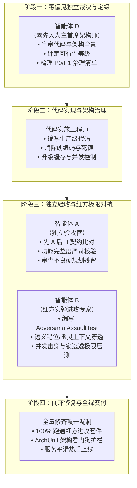

# 🛡️ P 级事故与关键重构多智能体协同攻防 SOP（标准作业规范）

> **建立时间**：2026-10-05  
> **适用范围**：系统核心链路故障（P0/P1）、架构级重构、生成式 AI 与规则引擎重大边界缺陷。  
> **核心原则**：**中立裁决、编码落地、独立挑刺、红方攻击、100% 自动化闭环**。

---

## 👥 四大智能体协同职责矩阵

### 1. 智能体 D（Clean-Slate Independent Architect）
* **定位**：完全客观、不带任何既往历史包袱的第三方首席软件架构师。
* **职责**：
  - 零偏见对代码库、分层架构、数据流与并发机制进行实地深度审查；
  - 给出明确的可行性定级结论（【条件可行】/【不可行】/【优秀可行】）；
  - 输出结构清晰的 P0 / P1 / P2 问题与风险矩阵。

### 2. 代码实施工程师（Implementation Worker）
* **定位**：严谨落地生产级代码的工程实施者。
* **职责**：
  - 按照 P 级清单实施架构重构（如 Caffeine+Redis 分级缓存、细粒度会话锁、语义解耦）；
  - 严禁任何形式的敷衍式硬编码与假规划（如固定景点模板、写死特权 ID）。

### 3. 智能体 A（Functional Acceptance Reviewer）
* **定位**：先 A 后 B 严苛审查员 / 架构验收官。
* **职责**：
  - 对重构后代码进行逐行契约对比（四分类：已验证一致、明确获准的变化、回归差异、尚未核实）；
  - 严打不良硬规划（如未解除的景区写死特判、时空倒流、无限死锁）；
  - 运行单元测试套件核验。

### 4. 智能体 B（Adversarial Red-Team Attacker）
* **定位**：顶级红方渗透与极限攻防专家。
* **职责**：
  - 针对刚修完的代码编写**专属红方进攻测试套件**（如 `RedTeamAdversarialAssaultTest.java`）；
  - 实施 4 大极限战役：
    1. **语义错位与上下文穿透**（声东击西、口语化无词缀提问、复合多实体混淆）；
    2. **并发碰撞与锁逃逸**（多会话并行吞吐、同一会话多线程竞争、锁清理边界穿透）；
    3. **提案存储与缓存溢出**（万级并发写入、过期提案反向续命检测、异步非阻塞）；
    4. **不良硬编码地毯式排查**（假规划模板、特权景区 ID 偷懒逻辑）。

---

## 🔁 交付验收标准（DoD）
1. **智能体 A 验收全绿**：所有修复项经智能体 A 核验无降级、无反向依赖污染；
2. **智能体 B 进攻套件 100% 命中且通过**：针对 B 挖掘的漏洞逐一修复，进攻套件全部跑绿；
3. **架构看门狗（ArchUnit）零违规**：领域层纯洁度与依赖倒置（DIP）坚如磐石；
4. **服务平滑热启**：Spring Boot (8080)、Node BFF (3000)、Vite Frontend (5173) 全量健康在线。
