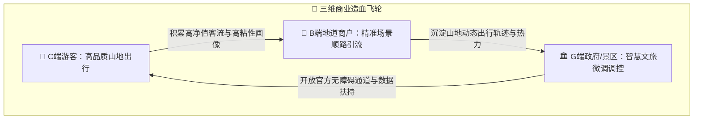
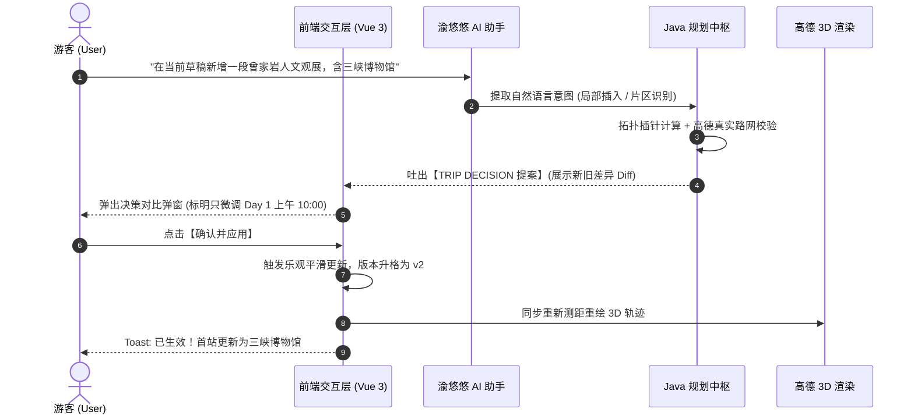
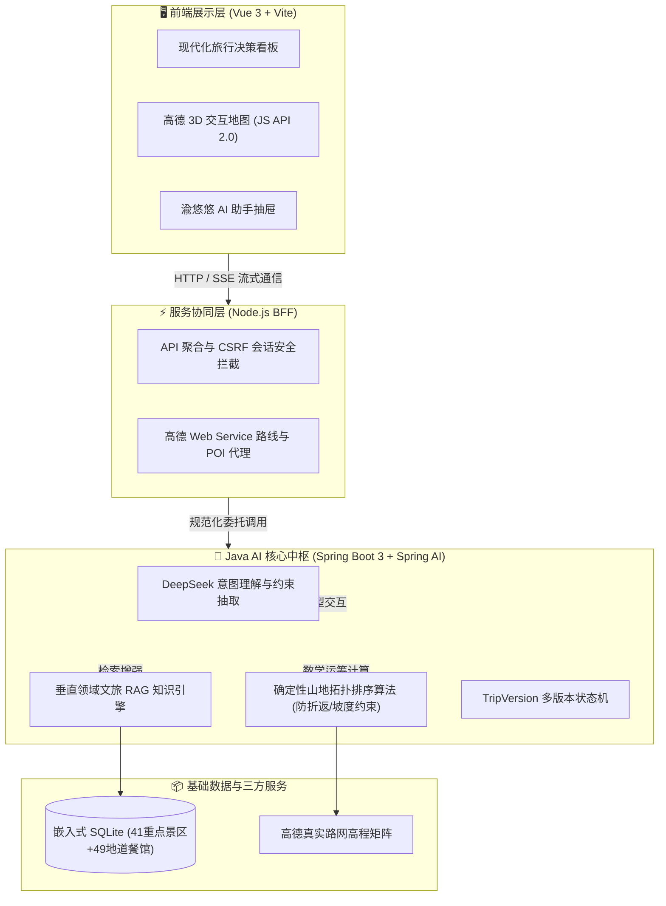
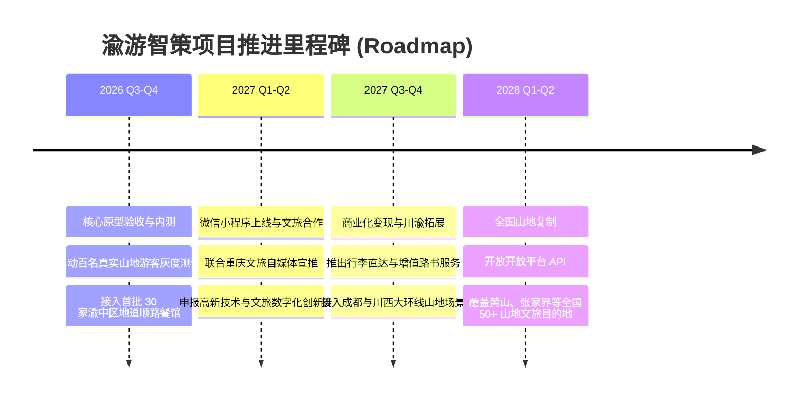

# 《渝游智策》—— 基于立体时空拓扑与智能协同的重庆山地文旅 AI 决策中枢

> **赛道方向**：“互联网+”大学生创新创业大赛 / 创青春 / 商业创新孵化  
> **项目定位**：国内首个面向复杂高落差山地场景的“伴随式 AI 旅行规划与动态决策系统”  
> **核心标签**：AI Agent 垂直应用 · 山地立体拓扑算法 · 适老与亲子友好 · 智慧文旅 SaaS

---

## 目录 (Executive Overview)
1. **项目摘要与投资亮点 (Executive Summary)**
2. **市场分析与痛点洞察 (40% 商业板块 - 为什么做)**
3. **商业模式与盈利飞轮 (40% 商业板块 - 怎么赚钱与规模化)**
4. **产品架构与核心交互体验 (30% 产品板块 - 做出什么产品)**
5. **技术壁垒与工程护城河 (30% 技术板块 - 凭什么能做成)**
6. **运营落地现状与未来里程碑 (Traction & Roadmap)**

---

## 一、项目摘要与投资亮点 (Executive Summary)

* **市场痛点**：重庆作为全国文旅第一顶流（年游客超 3.2 亿人次），其“8D 赛博立体山地地形”带来极高出行门槛。传统导航与平台存在“直线距离欺骗（平面 200 米，垂直落差 50 米爬楼 20 分钟）”、“百级台阶体能透支”、“跨江反复折返”三大顽疾。通用大模型（如 ChatGPT）更是存在“地理时空幻觉、缺乏路网测算、一旦修改一个景点整单推翻重来”等致命缺陷。
* **产品方案**：打造**《渝游智策》**——以“防折返时空排程 + 垂直高差感知 + 会话式局部微调（In-place Decision）”为双核驱动，为老年、亲子家庭及自由行游客提供“不走回头路、避开陡峭台阶、随走随调”的伴随式智能管家。
* **技术护城河**：摒弃传统“套壳 Agent”，首创**“大模型自然语言意图理解 + 确定性拓扑运筹排序算法”**双轮架构，融合高德真实路网高程矩阵与 90+ 垂直精调文旅知识库，从数学机制上 100% 杜绝地理幻觉。
* **商业价值**：构建 **B2C 增值服务 + B2B 顺路地道商家引流 + B2G 山地客流智能疏导** 的三维造血飞轮，以重庆为山地文旅标杆，快速横向复制至全国 50+ 复杂山地与山海文旅目的地。

---

## 二、市场分析与痛点洞察（占比 40%：商业与市场）

### 1. 市场空间测算：万亿文旅与银发山地蓝海
* **TAM（全国智慧旅游总市场）**：我国在线文旅与智慧文旅数字化市场规模突破 **1.2 万亿元**；
* **SAM（山地与高落差文旅特色市场）**：以重庆、张家界、黄山、青岛、武夷山等为代表的山地立体文旅市场规模超 **1,800 亿元**；
* **SOM（重庆及成渝都市圈目标服务市场）**：2025 年成渝地区双城经济圈自驾与自由行深度游客人次超 1.5 亿，按 15% 智能导览与数字化出行服务渗透率测算，核心可触达市场约为 **22.5 亿元/年**。

### 2. 行业政策利好
* 落实国务院《十四五旅游业发展规划》及《关于进一步激发文化和旅游消费潜力的意见》；
* 响应全国文旅系统**“无障碍旅游适老化改造”**号召，重点解决老年人、障碍人士在山地旅游中的“体能痛点”与“数字鸿沟”。

### 3. 三大现实矛盾与竞品分析

| 痛点维度 | 传统平台（携程/美团/小红书） | 通用大模型（如直接问 DeepSeek/ChatGPT） | 《渝游智策》（本项目） |
|---|---|---|---|
| **山地立体地形识别** | ❌ 仅看二维平面直线，忽略百级台阶与高差 | ❌ 严重地理幻觉，常给出“悬崖穿墙”、“逆向翻山”荒谬建议 | ✅ **首创山地坡度约束模型**，优先规划皇冠大扶梯、凯旋路索道等立体代步 |
| **时空闭环与防折返** | ❌ 碎片化攻略拼凑，跨区来回倒流耗费体力 | ❌ 无真实高德路网与开闭馆营业时间约束 | ✅ **确定性时空拓扑运筹**，片区内平街闭环串联，严格防无效折返 |
| **行程微调机制** | ❌ 纯手工增删，无联动计算 | ❌ **推倒重来**：让其加一个景点，整份规划全部重写 | ✅ **会话式局部智能微调**：局部 Diff 提案对比，保留既有骨架，平滑升格 v2 |
| **商业变现路径** | ⚠️ 硬广推销、佣金竞价，用户反感 | ❌ 纯对话工具，无法商业闭环 | ✅ **顺路场景化转化**，高粘性无感导流，全链条服务聚合 |

---

## 三、商业模式与盈利飞轮（占比 40%：商业与市场）

项目采用 **“以 C 端体验切入立口碑，以 B 端商户导流促变现，以 G 端政企赋能扩规模”** 的三维飞轮商业模式：

### 1. B2C 游客端：增值服务与体验变现
* **山地无障碍路书尊享版（19.9 元/单）**：提供包含高清离线山地 3D 轨迹图、实时客流错峰避堵预警、无障碍电梯/洗手间坐标指示的高精度数字路书；
* **“山地轻松行”行李直达联动服务**：与本地行李托运平台战略合作，游客抵渝后行李直接送达酒店，游客无箱一身轻直接开启爬坡逛街，抽取 15% 平台服务费；
* **适老化伴随式语音助手**：支持地道方言语音对讲，子女远程可一键同步老人行程与步数体力负荷。

### 2. B2B 商户端：基于行程拓扑的“顺路非硬广导流”
* **场景化无感推荐**：区别于传统大众点评的“竞价霸屏”，本系统在排程到曾家岩、戴家巷等节点时，只智能推荐步行 5 分钟内、无需爬坡的“防空洞特色火锅”、“老字号小面馆”；
* **收益模式**：按有效进店及到店券核销（CPS / CPA）进行抽佣，平均佣金比例为 5%~10%。

### 3. B2G 景区与文旅局端：山地智慧文旅微调大脑
* **山地客流削峰填谷**：在洪崖洞、千厮门大桥、磁器口等极易拥堵节点，系统在给游客智能微调时，通过“优惠激励”引导游客错峰前往戴家巷或曾家岩人文街区，协助文旅局进行客流热力疏导；
* **数据看板与文旅决策 SaaS**：向文旅局及景区管委会输出《重庆山地游客体能与路线行为分析报告》，收取政企 SaaS 订阅服务费。

### 4. 财务预测与横向扩张计划（3 年规划）
* **第 1 年（重庆样板工程）**：深耕渝中区及主城九区，服务 50 万自由行游客，签约 200+ 顺路特色商户，预计实现年营收 **320 万元**，达成收支平衡；
* **第 2 年（川渝双城协同）**：拓展成都、乐山大佛、峨眉山等西南特色山地景区，年服务用户突破 200 万，预计营收达 **1,200 万元**；
* **第 3 年（全国山地复制）**：将模型向张家界、黄山、青岛、武夷山等 50 个高落差城市全面推广，建立全国最大的“山地立体出行 AI 基础设施”，预计营收突破 **3,800 万元**。

---

## 四、产品架构与核心交互体验（占比 30%：产品与体验）

### 1. “三屏合一”现代化交互看板
用户打开主界面，直接呈现实时交互看板，摒弃传统繁琐表单：
* **左屏·结构化多版本行程单**：以天为单位，高亮标注“景点建议时长”、“山地坡度友好指数”、“垂直代步提示（如皇冠大扶梯）”；
* **中右屏·高德 3D 真实轨迹与地形**：结合高德 JS API 2.0，动态呈现带高程差的彩色折线轨迹，支持点击 POI 镜头平滑飞跃定位；
* **右侧抽屉·“渝悠悠”伴随式 AI 助手**：随时响应自然语言，充当随时待命的本地土著导游。

### 2. 杀手锏功能体验：会话式局部智能微调 (In-place Decision)
针对传统 AI“一动全乱、必须推倒重来”的核心缺陷，本项目首创**行程版本局部插针技术**：

* **用户获得感**：游客只需像朋友聊天一样发一条消息，原先 90% 的行程安排毫不受损，仅将新景点天衣无缝地落位，让微调零心智负担。

### 3. 多版本历史时光机 (Version Control)
* 行程单顶部常驻版本切换栏（如 `v1 初始规划` 与 `v2 局部微调: 三峡博物馆`）；
* 游客在旅途中可一秒在不同预案之间来回自由切换，所有路线与地图秒级联动回溯。

---

## 五、技术壁垒与工程护城河（占比 30%：技术与实现）

针对评委最关心的**“是否套壳大模型”**质疑，本项目给出了极其硬核的技术答案：

### 1. 核心技术壁垒一：大模型意图抽取 + 确定性拓扑运筹双轮驱动
* **痛点根源**：直接让大模型生成行程，大模型存在“幻觉”（比如它会告诉你从洪崖洞步行 5 分钟到南山一棵树，实际上需要跨长江还要爬大山）；
* **本系统解法**：
  * **让大模型做大模型最擅长的事**：DeepSeek 仅负责将用户的自然语言“翻译”为结构化的约束（如：`{ target: "三峡博物馆", duration: 120, max_slope: "gentle", companion: "elderly" }`）；
  * **让数学运筹学做排程的事**：Java 后端基于有向无环图（DAG）及片区聚类拓扑算法，结合高德路网矩阵计算最短阻力路径，**从工程上 100% 根除大模型地理幻觉**。

### 2. 核心技术壁垒二：山地适老体力量化模型
* 系统引入山地消耗等效公式：
  $$\text{Energy Cost} = \alpha \cdot \text{Distance} + \beta \cdot \max(0, \Delta h) - \gamma \cdot \text{Mechanical Aids}$$
  （其中 $\Delta h$ 为实际高程差，$\text{Mechanical Aids}$ 为扶梯/缆车等代步减免系数）；
* 当检测到随行人员包含“父母/老人”时，系统强制触发无障碍闸门，严格过滤倾角超过 15° 的步道与无电梯级差。

### 3. 核心技术壁垒三：企业级工程解耦与离线高可用
* **三层解耦**：前端专注于渲染与 3D 地图流畅度，BFF 保证密钥绝不出网并承载高并发代理，Java 后端作为唯一业务权威（Single Source of Truth）；
* **自包含嵌入式知识库**：采用 SQLite 嵌入式架构，开箱自带 41 个重点景区、49 家地道美食与历史步道数据，即使在弱网环境下依然能稳定吐出高质量规划。

---

## 六、运营落地现状与未来里程碑 (Traction & Roadmap)

### 1. 当前研发与落地进展 (Traction)
* ✅ **原型工程全线跑通**：已完成 Java 后端、Node BFF、Vue 3 前端的全栈联调，所有核心 API 与自动化测试 100% 通过；
* ✅ **高德商业级 API 深度集成**：完整打通高德 Web Service 步行/公交多模态路径规划与 JS API 2.0 三维渲染；
* ✅ **多场景测试验证**：已完成 20 组重庆典型游玩路线（如渝中半岛平街人文游、九龙坡艺术游、南岸山城步道慢游）的 Golden Demo 验证。

### 2. 未来 18 个月推进里程碑 (Milestones)

---

## 结语：答辩金句提炼 (Pitch Wrap-up)

> **“在平原城市，旅行是一张二维地图；但在重庆，旅行是一场三维立体的空间折叠。  
> 传统软件只看直线，而《渝游智策》真正读懂了山城的高度与温情。  
> 我们用 AI 意图理解消除操作成本，用拓扑算法拉平千级台阶，不仅让每一位年轻人享受行云流水的山城漫游，更让每一位银发老人能从容拥抱 8D 重庆的壮美风光！”**
