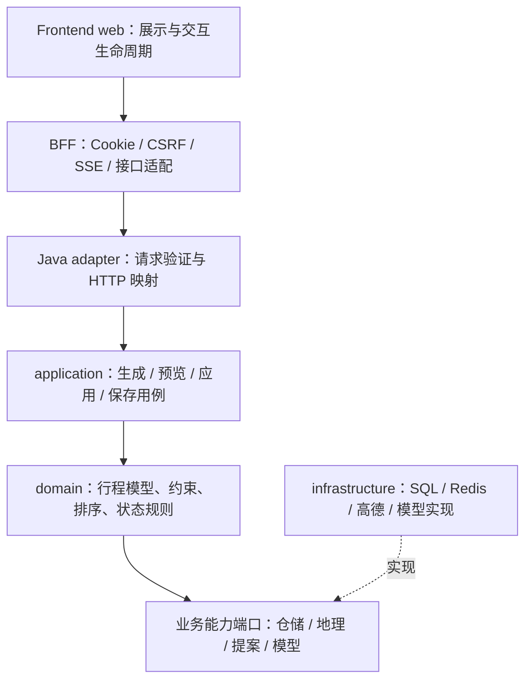

# 渝游智策重构优化方案与辅助智能体验收规范

版本：1.0；编写日期：2026-10-07。状态：**设计与执行规范，尚未实施本文件中的架构重构**。

本文基于当前源码审查与本次提交前回归，保存已有修复的行为边界，并规划下一阶段的渐进重构。文中“目标”“应”“验收”均为后续要求，不代表当前实现已满足。历史报告如与实际代码、测试覆盖或本文件限定条件不符，以当前证据为准。

## 1. 范围、仓库与基线

系统有三个独立 Git 仓库；一次 Git commit 只能提交一个仓库。三个仓库各保存一次中文提交，通过提交清单组合成同一版本基线，不合并 Git 历史，不推送远端。

| 仓库标识 | 当前本地位置 | 提交前 HEAD | 本次提交主体 |
| --- | --- | --- | --- |
| Java | `D:/scenic-guide`，模块 `ai` | `7f4bc63` | Java 业务代码、资源、回归测试、相关设计文档与审计脚本 |
| BFF | `loop-p0-functional-inventory-1-home` | `7efdb9c` | `server/` 中的接口适配、偏好、规划和持久化修复及测试 |
| Frontend | BFF 目录下独立仓库 `frontend/` | `f04bdae` | 实际运行入口 `web/` 的交互、状态隔离与测试 |

提交后完整 commit SHA、实际提交文件与验证结果写入本次交付清单。本文自身不填写它所在提交的 SHA，避免自引用。重构开始前必须重新记录三仓库 HEAD、工作树差异、配置版本及测试基线；不能把本文日期当作未来的版本依据。

真实前端由 `vite --config vite.config.ts web` 启动。`frontend/src` 中保留的 Vue 目录不能代替当前 `web/` 入口做验收。Java 当前是一个 Maven 业务模块，按包划分 adapter/application/domain/infrastructure；无需为了名称接近 COLA 强拆 Maven 模块。

依据：[COLA 官方仓库](https://github.com/alibaba/COLA)。借鉴的是以业务为核心、分离技术与业务复杂度和依赖倒置；不将“用了 COLA 包名”视为架构完成，也不要求更换框架或立刻微服务化。

本次保存不包含运行数据库、环境密钥、日志、node_modules、dist、商业计划书、临时代理片段与无关本地启动材料。未纳入的工作树文件保留原状。BFF 的 `.gitignore` 当前忽略 `scripts/`、`work/`；历史本地测试不能因此被算成新克隆仓库的完整可执行测试集。

## 2. 当前判断与实际驱动

现状是具备部分领域端口和策略的 COLA 风格模块化单体。分层方向合理，局部调整、版本控制和两阶段确认已有保护，问题主要在职责、模型和状态权威。

| 已核实的设计债务 | 当前证据 | 实际影响 | 优先级 |
| --- | --- | --- | --- |
| 领域包含数据库、缓存及供应商实现 | domain 直接导入 JDBC 11 文件、Redis 5、Spring AI 9、Spring HTTP 客户端 1；集合可重叠 | 业务规则难独立替换、测试需了解技术实现 | 高 |
| 规划应用层较薄 | `PlannerApplicationService` 以转发为主；`PlanAdjustmentService` 同时处理续接、提案、版本与应用 | 改一个状态转换需跨许多职责理解副作用 | 高 |
| 核心仍使用可变 Map 和 HTTP 式结果 | `PlannerSession`、存储快照、`Trip.plan`；`PlannerService.ServiceResult(int status, Map body)` | JSON 漏字段、旧路线残留、无效状态组合更难约束 | 高 |
| BFF 与 Java 都保留业务判断 | BFF 的意图分类、目标定位、偏好补丁与 shadow 路由 | 不同入口可能解释同一句话不同；需先确认调用者 | 中高 |
| 业务包存在静态依赖环 | attraction/dining/memory/planner/trip 的 import 强连通组 | planner 容易成为通用能力杂物箱，模块难独立替换 | 中 |
| 提案缓存与会话权威生命周期不同 | 本地锁、epoch、续接队列与 Redis 提案快照共存 | 使用 Redis 不等于重启或多实例后仍可安全续接 | 高（扩容前） |
| 全局初始化与大类集中 | `KnowledgeDbConfig` 及规划/聊天多个类承担多类工作 | 迁移恢复、事务边界和定位问题的成本较高 | 中 |

静态基线：生产 Java 238 文件，其中 domain 165；较大类原始行数为 RuntimeLocationPlanner 1561、ScenicDataImportService 1302、PlanAdjustmentService 1260、ConversationIntentClassifier 1060、ChatApplicationService 1016、ItineraryBuilder 997、KnowledgeDbConfig 966、PlannerService 949。BFF 的 index.mjs 3053、java-core-client.mjs 1302。行数含注释，是定位线索，不设置“低于某行数即合格”的指标。

当前架构守卫 6 项通过，只能证明其既定包引用规则。它未完整覆盖第三方技术职责、状态一致性和行为等价。静态 import 环也不等于已证实的 Bean 循环或运行死循环。

## 3. 目标与边界

### 3.1 必须达到的目标

1. Java 统一拥有规划决策、正式偏好、行程版本和提案状态权威，BFF 不再复制同一规则。
2. application 拥有用例协调，domain 拥有业务规则和不变量，infrastructure 实现外部能力与存储。
3. 核心行程、调整和结果逐步强类型化，HTTP 与兼容 JSON 转换留在边缘。
4. 状态转换可审计，旧提案、旧工作区和并发请求不能错误修改新行程。
5. 每个阶段独立可编译、可回归、可回滚；旧入口移除有实际调用迁移证据。
6. 外部搜索、模型、路线、语音及检索失败有明确结果，界面不能把失败显示成成功。

### 3.2 本轮不默认实施的事项

不整体替换框架，不立即拆微服务，不批量修改所有包名，不重写已有算法，不借重构静默改变用户偏好或历史行程。不承诺“0 硬编码”“完全无 bug”或未实测的性能提升。

已确认的业务缺陷修复与行为等价重构要分别登记。新增多实例部署、真正的偏好候选过滤、算法权重调整或持久化格式切换分别作为明确的功能/数据变更执行；不包装成纯文件搬迁。

## 4. 目标架构与依赖



虚线代表实现关系，不是运行调用箭头。启动装配选择端口实现；业务用例通过接口调用外部能力。

| 层/组件 | 应承担 | 应移出的职责 |
| --- | --- | --- |
| adapter | 身份上下文提取、DTO 校验、业务结果到 HTTP 的映射 | 时间间隙算法、SQL、意图规则与用例编排 |
| application | 用例顺序、幂等与事务协调、加载状态、调用规则、提交结果 | 具体 SQL、供应商响应解码和纯规划算法 |
| domain | 业务模型、时间/路线/保护规则、提案合法转换、排序语义 | HTTP 状态码、JdbcTemplate、Redis 命令与供应商 SDK |
| infrastructure | 仓储实现、缓存、网络客户端、序列化与迁移执行 | 重新解释用户意图、独立决定行程版本 |
| BFF | Web 身份桥接、Cookie/CSRF、流转发、必要展示适配 | 复制 Java 的意图、偏好和行程变更决策 |
| Frontend | 用户确认、显示状态、工作区所有权、失败恢复、地图渲染 | 将文字回复当成功凭据或绕过服务器约束 |

不是所有 Spring 注解都违规，也不机械禁止 application 引用技术装配。架构规则应按实际职责约束，例外需有文件、原因、替代计划和复查日期。

推荐端口按能力划分：MemoryRepositoryPort、ProposalRepositoryPort、IntentExtractionPort、ChatModelPort、KnowledgeRetrievalPort、RerankPort；继续复用已有 GeoRouteGatewayPort、PlannerSessionRepositoryPort、TripRepositoryPort。新增名称为设计建议，不能认为当前已有实现；不要给每个方法创建只有一个实现、没有业务边界的接口。

共享地理与语言能力放入有明确输入、输出和所有者的能力边界。先检查引用方向和组合方式，再消除跨域对具体实现的引用；不把所有环一股脑搬到 common。

## 5. 业务与数据权威

| 对象 | 唯一权威 | 其他层允许保存的内容 |
| --- | --- | --- |
| 账号、访客设备与资源归属 | Java 的资源授权校验；BFF 提供经过验证的 Web 身份 | 不可伪造的身份桥接；UI 仅作展示 |
| 规划 session、revision 与正式 trip ID | Java 用例与仓储提交结果 | 客户端保存当前显示版本，不代取最新版本掩盖冲突 |
| 提案、取消、epoch、续接队列与幂等结果 | Java 中一致的状态权威 | BFF 透传不透明标识；UI 保存关联信息，不生成凭据 |
| 记忆及有效期、确认、删除 | Java 正式记忆数据 | BFF/Frontend 派生画像和展示分组，可重建且需标版本 |
| 当前页面工作区 | Frontend 工作区生命周期 | 服务端工作区快照；响应应用前验证归属和版本 |
| POI、路线与开放信息 | 对应来源及来源时间；通过网关得到 | 有版本/TTL 的缓存，缺失即缺失，不补假事实 |

访客缓存使用实际设备身份，不能所有访客共享一个键。登录、退出、切账号、恢复旧工作区、反馈、确认及删除均重新核对所有权。请求正文中的 userId/deviceId 不可替代经过验证的身份。

### 5.1 拟建立的类型

优先引入 TripDraft、DayPlan、StopPlan、AdjustmentPreview、BusinessResult，而非一次将所有 Map 转为实体。典型字段应包括稳定 ID、实际日期或明确未知、起止时间、地点与坐标来源、路线状态、保护约束、来源证据、版本、兼容 extras。

所有值在构造或规则验证处校验：坐标合法范围、时间块不倒置、停留与路程单位明确、站点 ID 稳定、日期不可凭空生成、版本不回退。未知与失败不能被数值 0 混用。模型结果提供业务错误码，adapter 映射现有 HTTP 状态并保留响应字段。

S1 必须定义 extras 与类型核心字段冲突时的优先级：不可允许扩展字段覆盖经过验证的身份、版本、坐标与时间；转换遵循当前核心字段覆盖 extras 的行为。逐字段固定 absent（未提供）、null（显式空）与具体值的读取、默认和写出语义，给缺省、显式 null、未知嵌套字段、同名冲突分别建立 round-trip fixture；禁止无依据地把 null 全改成字段缺失。

### 5.2 JSON 与数据库兼容

执行顺序：样本快照 → 旧 JSON 读取适配 → 类型化规则 → 保持旧写出契约 → 明确版本的新写出（若确需）。必须测试旧→新→旧的语义往返，保留未知扩展字段、身份、站点顺序、坐标来源、固定状态及路线展示字段。不能只比较反序列化不抛异常。

不直接重写全部历史数据。新增 schema/serializer version 的缺省必须能读取旧数据；若旧 reader 不能读取新 writer，则先保留兼容写出或限制回滚窗口，不能承诺随时回滚代码即可恢复数据。

数据库迁移使用独立临时 SQLite 和隔离 PostgreSQL 测试环境（后者需实际运行后才能报通过）。记录迁移前后字段、行数、ID、版本、唯一性、失败重试与部分完成恢复。备份与恢复演练先于不可逆迁移。Git revert 不能撤销数据库写入；数据回滚步骤、恢复时点与丢失窗口需单独说明。

KnowledgeDbConfig 逐步收口为基础连接与迁移装配，将各域 schema 变更放入对应版本迁移；避免启动过程中各服务随意改表。迁移暂不引入新工具作为硬前置，先保证脚本版本与重复执行语义。保留现有迁移登记及事务语义，不另建第二套版本表导致历史迁移重复执行。

## 6. 规划、聊天与界面状态契约

### 6.1 用例拆分

GeneratePlan：验证身份与输入 → 解析约束 → 获取候选与路线 → 生成并验证 → 提交会话版本 → 返回真实结果。

PreviewAdjustment：加载指定版本 → 判断续接或新指令 → 提取结构意图 → 运行调整策略和范围校验 → 返回需要澄清/无候选/可确认预览。预览不修改正式行程。

ApplyAdjustment：验证提案归属、有效性、epoch、baseRevision 与幂等 → 验证状态 → 原子提交版本与提交凭据 → 返回实际变更和剩余任务。重复提交相同凭据返回同一结果，不重做追加。

SaveTrip：确认 session 与正式 trip 映射 → 校验归属与预期版本 → 原子保存与映射 → 返回稳定 ID。重试不产生第二个正式行程。

网络调用与模型生成不放在长数据库事务或会话锁中。先读取版本并生成，提交时重新 CAS；取消/应用/新生成的竞争由同一状态权威判定。若迁移改变锁范围，必须先证明不会扩大旧响应生效窗口。

### 6.2 状态机要求

目标状态可表示为 NEEDS_CLARIFICATION、NO_CANDIDATES、READY_TO_CONFIRM、APPLIED、CANCELLED、EXPIRED、CONFLICT。它们是建议的内部类型，**不是立即修改现有 wire 协议**。

| 操作 | 允许转换/结果 | 不变量 |
| --- | --- | --- |
| 信息不足 | 请求 → NEEDS_CLARIFICATION | 不伪造 POI，不假称已安排 |
| 无候选或供应商失败 | 请求 → 明确无候选/失败结果 | 不生成可应用的空调整，不冒充路线警告 |
| 生成预览 | 请求 → READY_TO_CONFIRM | 记录归属、版本、epoch、范围、有效期和差异 |
| 确认 | READY_TO_CONFIRM → APPLIED | CAS、幂等、固定站与保护范围验证全部通过 |
| 取消 | 未应用的预览 → CANCELLED | 旧预览此后不可应用，前端等待成功再清状态 |
| 已应用后取消 | 返回已应用/冲突事实 | 不说“行程未发生改变”，明确实际状态 |
| 新完整指令/重新生成 | 更新会话代次，失效旧续接与相关预览 | 晚到旧响应不能附着新行程 |
| 版本/代次不符 | → CONFLICT/EXPIRED | 不自动代取最新版本强行应用 |

“不要取消”不触发取消；“取消”与“先别执行剩下的任务”要根据已确认的业务范围处理。组合任务按独立目标、日期、时段存储；原始序号与选择项稳定，不以同类 intent 直接合并。

新完整命令覆盖旧目标；真正的补充槽位才继承。新目标配无效时间时保留新目标并澄清，不能偷偷恢复旧目标。选择方案 A 后应进入明确预览或追问缺失字段，不能继续输出整篇重复规划文章。

### 6.3 地理、时间与餐饮

结构化意图保留原请求和可解释检索词；“吃点甜食”“吃点甜食的”应归一到相同语义类别，但不靠不断追加名词词根正则实现。地理中心由实际当天站点动态计算；冷启动使用城市动态地理编码。跨度大时的锚点选择必须明示规则并回归跨城市请求。

用餐区间是可配置业务约束，午餐 `[11:30,13:30]`、晚餐 `[17:30,19:30]`；不是固定插入时刻。扫描已占时间块，加入前后路线耗时，验证完整停留区间。没有可行间隙就返回原因/替代选择。路线失败或缺失不能当零分钟；秒到分钟采用保证不低估的转换。

局部修复保护未授权部分与固定站点；用户允许加站不代表允许压缩固定站停留。`force` 不能绕过物理时间冲突。改坐标后失效所有路线来源字段；新首站移除不适用的入站路线，保留地点自身开放/无障碍事实。

### 6.4 偏好与画像

同义甜食记忆在展示与画像中合并看待；辣口与甜口可同时存在，不能互斥覆盖。合并保留原记忆 ID、来源、确认、有效期和独立删除语义；过敏、禁忌等安全事实不因合并而丢失。不能因“饮食习惯”分类就推导清淡或嗜辣，不能因“同行”推导情侣，不能因预算类别推导预算有限。

优先级：本次明确输入 → 用户确认的结构化偏好 → 有效历史叙述，冲突按字段处理；手工备注不被自动重提炼冲掉。当前自然语言历史注入主要影响叙述，**不能声称已完整影响所有候选过滤与排序**。后续如实现结构化投影，需单独设计字段来源、置信度、有效期、用户覆盖和排名贡献，并验证实际候选变化。

永久记忆不丢在“近期前 50 条”后面；分页需稳定排序与重复页检测。模型预算不足时优先保留安全限制并说明截断，存储和编辑仍保留完整数据。

### 6.5 Frontend 与 BFF

首次解释聊天模式“以对话为主导”和调整模式“以局部修改为主导”；切换明确提示“切换至 XX 模式”，不增加用户已要求移除的动画。点击建议 tab 自动进入调整模式也同步显示模式和选择来源。

陈旧消息中的 tab 必须核对其会话/提案/工作区，过期时明确提示重新预览；不能把 5–6 轮前的操作当当前新操作。无候选、失败、需要澄清与可强制继续的路线建议显示不同操作，不给无候选结果提供“仍按此方案调整”的假成功入口。

每次异步请求捕获账号、工作区、代次/版本。返回时重新校验，只更新仍属于它的界面。取消等待服务端结果，失败保留可重试状态；应用中不得并发清掉申请；关闭提示只改展示，不等于服务器取消。SSE disconnect/abort/timeout 明确清理资源和请求计数，旧流不能覆盖新消息。

BFF 收口前建立 endpoint、调用者、请求/响应 DTO 与错误码清单；主网页和旧调用分别追踪。shadow 若仅用于比较，不得二次提交；旧路径是否仍被使用未核实前不能删除。

## 7. 分阶段实施与退出条件

顺序按依赖安排。每阶段一个可验证切片，结束后再扩展；各阶段的提交粒度为建议，不代表此次已执行。

| 阶段 | 内容与试点范围 | 前置/交付 | 必须退出条件 | 回滚方式 |
| --- | --- | --- | --- | --- |
| S0 基线与契约 | 三库版本、实际入口、API/状态/存储样本、测试归属、部署限制 | 本文 + 可执行基线清单；补齐未跟踪关键测试 | 干净克隆能运行声明的测试；待验证项单列 | 不改业务，只撤回新增门禁/文档 |
| S1 类型化试点 | 先选一个加站/换站预览链路，引入 StopPlan/AdjustmentPreview 与兼容转换 | S0；不改 wire 与存储写出 | 原/新样本语义往返、异常输入、范围保护、旧字段保留通过 | 保留原 converter/serializer，回切用例 |
| S2 记忆与存储端口 | 从 TravelMemoryService 提取查询/写入仓储，纯投影规则留领域 | S0，允许与 S1 在不共享文件时并行 | 永久分页、有效期、删除、多口味、手工备注、账号隔离一致 | 切回旧实现，不回退数据版本 |
| S3 提案及外部能力端口 | ProposalStore、意图/模型/重排的技术实现外移；明确本地 epoch 限制 | S0；状态契约先固定 | 取消/确认并发、TTL、Redis 不可用、模型畸形/超时回归 | 接口保留，装配切回；已提交操作不撤销 |
| S4 用例层收口 | Generate/Preview/Apply/Save 的事务协调移 application，规则留 domain | S1、S3；先 Preview 再 Apply/Save | 两阶段、CAS、幂等、稳定 ID、剩余队列与晚到响应通过 | 逐用例回切，同一权威继续有效 |
| S5 BFF 决策收口 | 移除经证明重复的意图/偏好决策，拆路由与 DTO 适配 | S4 + 真实调用清单 | 每入口请求数、错误码、旧客户端兼容、无二次提交通过 | 保留有限兼容 adapter，禁止双写 |
| S6 能力边界与迁移治理 | 消除模块对具体实现的反向引用，收口 schema 迁移和聊天协作者 | 对应 S2–S5 稳定 | 新增技术导入为零；存量例外下降；迁移恢复、检索/语音回归 | 代码与数据回滚分别演练 |
| S7 持续门禁与性能优化 | 三库契约流水线、架构规则、故障注入、实测瓶颈优化 | 各试点形成证据 | 冷克隆可重现；性能对比有样本且正确性不降 | 撤回单项优化，保留正确性门禁 |
| S8 多实例（条件阶段） | 持久化 epoch/队列/取消/幂等及跨实例原子转换 | 明确扩容需求；S3/S4 已稳定 | 两实例、重启、故障切换真实运行并通过 | 回到明确单实例部署；不得读取不兼容新状态 |

S0 完成前不将本文全部阶段交给智能体同时执行。S1 与 S2 只有文件、数据和测试资源隔离时并行；S4/S5 按顺序集成。性能优化需先测量 SQL、模型、路线或渲染实际耗时，不能以拆文件数量计算收益。

S3 即验收单实例重启：Redis 可命中旧提案而本地 epoch 已丢失时，旧提案必须 fail closed，提示重新预览；不能把默认 INITIAL 代次恢复成旧权威。这是现有安全行为的保持验收，不等到 S8 才测。S8 才设计并验证跨实例权威的持久恢复。

## 8. 验收矩阵：必须观察结果与副作用

以下为后续必跑验收，不代表每项在本次均执行。已有测试先映射并复用，缺项由独立验收者补针对性用例；每项标记自动/人工、环境、结果、证据路径及对应版本。

| 编号 | 场景/输入 | 判定与需要观察的证据 |
| --- | --- | --- |
| A01 | “我想吃点甜食”与“我想吃点甜食的” | 结构意图等价；候选事实或无候选原因真实；不误变成茶馆 |
| A02 | 北京/杭州/西安/武汉，驴肉火烧/螺蛳粉，陌生高校建筑 | 候选来自指定城市与真实来源；无城市坐标 fallback；陌生地点不靠名单否定 |
| A03 | 甜口、辣口、人文历史依次确认并保存 | 重载仍存在；同义合并、独立来源和安全事实保留；画像与实际字段一致 |
| A04 | 旧画像手工备注 + 新记忆/删除旧住宿偏好 | 增量融合；旧投影清理不删新值；删除后不再自动注入 |
| A05 | 超过 100 条记忆含永久、禁用、过期、重复页 | 永久有效项完整；禁用/过期不注入；重复页显式失败不死循环 |
| A06 | 多步组合任务，同类型不同日/时段；“跳过第 2 个” | 队列按原始序号准确处理；已应用不重复；跳过/取消剩余边界明确 |
| A07 | 旧目标 + 新完整命令；新命令含无效时间 | 新目标生效，时间澄清；只补时间才继承旧目标 |
| A08 | 方案 A tab 选择；5–6 轮前旧 tab | 当前方案进入可确认预览/必要澄清；旧方案验版本；不重复整篇规划 |
| A09 | “不要取消”与真正取消 | 前者保持可应用；后者取消成功后旧 apply 冲突/失效，版本未被取消修改 |
| A10 | apply 与 cancel 竞争、新生成与旧预览晚到 | 用屏障控制交错，只有合法转换提交；最终版本/提案/队列一致；不虚报未修改 |
| A11 | 同一幂等申请重复、不同 baseRevision 重试 | 相同申请一次效果；过期版本冲突；不能重复添加站点或生成第二正式 ID |
| A12 | 无餐饮间隙、路线失败、停留跨区间、固定站 | 返回不可行/待确认事实；force 不绕过时间；固定和未授权片段完整保留 |
| A13 | 换站改坐标、改动第一站 | routeFromPrevious/walkingInfo/mapContext 等依赖失效；新首站无旧入站距离 |
| A14 | 秒级路线耗时、营业日与未知日期、加一天 | 耗时不低估；真实日期递增且休馆日过滤；未知日期不伪造营业结论 |
| A15 | 保存、恢复、再保存、旧版本删除 | 正式 ID 稳定；删除发送显示版本，缺失 428、过期 409；失败保留列表/工作区 |
| A16 | A/B 账号、两访客设备、切账号与晚到响应 | 请求/缓存/确认/恢复/反馈均不跨归属；旧响应不更新新工作区 |
| A17 | 未认证、越权 ID、伪造 userId、撤销 JWT | 接口拒绝；无数据库副作用；令牌和日志不暴露秘密 |
| A18 | LLM 返回畸形 JSON、含指令文字、超长组合请求 | 验证结构和业务范围；来源文字不能提升为系统指令；有可解释失败且预算有界 |
| A19 | 高德空/错坐标/超时、Redis/Qdrant/重排不可用 | 分别验证缓存键/短空结果 TTL/失效/降级；不编距离、设施和成功候选 |
| A20 | 关闭聊天、断开 SSE、取消失败、切工作区 | 流与资源清理；失败可重试；关闭展示与服务器取消分开；无旧流覆盖 |
| A21 | 首次用户、手动/建议 tab 切模式 | 首次用途说明、明确模式文字、无需切换动画；切换本身不多发规划请求 |
| A22 | 旧 JSON 带未知字段与非标准可选字段 | 语义 round-trip 保留；ID/版本/固定站/路线事实不丢；异常明确返回 |
| A23 | SQLite 重复迁移、部分迁移失败、PostgreSQL 方言 | 隔离库真实运行；迁移可恢复且记录版本，未跑 PostgreSQL 不标通过 |
| A24 | 检索、统计、PDF/语音、管理员配置 | 检索总数/限额/排序正确；PDF 有界；语音失败清晰；管理权限、保存与重读一致 |
| A25 | 两实例、重启、TTL/网络分区后续接 | S8 才要求真实验证；跨节点旧请求不能恢复已取消提案，幂等结果和版本一致 |

并发测试不能仅多发请求后“没有异常”就通过。需要可控制的屏障/闩锁，记录关键操作顺序和最终 DB/状态，分别测生成→取消→晚到、apply 先提交和 cancel 先提交。若只在单进程 mock 中运行，不写成多实例验证。

## 9. 辅助智能体协作与独立验收

### 9.1 职责与隔离

| 角色 | 工作 | 不应做的事 |
| --- | --- | --- |
| 主智能体/集成负责人 | 固定基线、拆任务、掌握授权、集成、全量检查、提交交付 | 将子智能体自述直接当验收结论 |
| 智能体 A：实施 | 一个阶段的明确切片，代码与必要测试；说明行为变化和风险 | 扩大范围、覆盖他人工作、顺手删旧入口 |
| 智能体 B：架构审查 | 读最新 diff 与调用链，核对职责、端口、身份/状态/事务权威 | 只看包名/行数就宣布通过；边审查边改 A 的同一文件 |
| 智能体 C：红方验收 | 从验收矩阵构造独立反例，验证真实入口、副作用、并发与失败恢复 | 只复制 A 的 happy path 或使用相同错误假设 |

可用资源不足时，B/C 顺序执行，角色和证据仍分开。任务分工使用子智能体，不为内部子任务擅自创建用户侧新聊天。不共享执行中的 Maven target 或数据库；主负责人统一跑全量 Maven，子任务使用隔离工作树、临时库或只读检查。

并行前列明文件所有者。两任务需改同一用例/模型/serializer 时按依赖串行或由主负责人统一集成。发现阻塞向主负责人报告，不让辅助智能体互相授权扩大变更。

### 9.2 派发模板

实施模板：

```text
阶段：Sx；版本：Java/BFF/Frontend 完整 SHA 与当前 diff 清单。
仅修改：明确文件/能力；禁止修改：相邻阶段和不相关文件。
保留契约：列出版本、身份、JSON、确认、固定站等具体不变量。
完成条件：指定验收项、命令、预期副作用与失败结果。
交付：diff、测试原始日志、行为变化表、未验证项、回滚条件。
如当前源码与描述不符，先核验并报告；不按历史报告盲改。
```

架构审查模板：

```text
只读审查当前切片及其实际调用方，不替实施者修改同一文件。
核对目标用例职责、技术依赖、HTTP/JSON 边界和唯一状态权威。
每个问题给文件行号、触发条件、实际影响、证据与最小修正建议。
区分：已验证一致 / 明确授权的变化 / 回归 / 未验证。
无问题也说明检查范围，不能宣称全项目无问题。
```

红方验收模板：

```text
从 A01–A25 中选择阶段相关项，独立检查现有测试后补其反例。
至少覆盖正常、无效输入、归属/版本、外部失败和一个状态交错。
使用测试账号、临时库和模拟供应商；记录真实入口和结果副作用。
若需真实供应商/多实例，给独立环境与费用边界，未运行即未验证。
报告测试文件、fixture、命令、退出码、SHA、最终状态与限制。
不以 mock 单元测试代称浏览器、真实服务或生产压力验收。
```

### 9.3 验收与返工协议

1. A 完成后由主负责人固定待审 diff；B/C 必须读取这一版本，而非旧报告。
2. B 给边界审查，C 给反例结果；主负责人核实引用、重现问题并决定修正范围。
3. 返工后重跑失败项与受影响契约；涉及共用模型、状态或协议再执行完整回归。
4. 聚合测试按测试身份去重，禁止把重跑或同一 fixture 算成新增覆盖。
5. 阶段只有在必跑项通过、未验证项与限制明确、回滚路径成立后才能完成。该阶段必跑项仍未验证时阻塞完成；可选真实供应商/S8 的未验证不冒充通过，也不无条件阻塞不涉及它们的切片。

验收者应在阅读实施测试前先写一个反例和期望不变量，再检查 A 的测试；记录独立输入、交错和副作用差异，避免两者共享同一个错误判定依据。

交付证据包含：阶段、三库 SHA、工作树状态、文件 hash、运行环境、命令、退出码、独立测试计数、跳过原因、原始日志、行为差异、问题修复对应关系。每个缺陷需有可重现触发条件；推测与设计建议单独列出。

## 10. 验证入口、测试可携带性与 CI

### 10.1 当前可运行的本地入口

以下命令在对应仓库执行；数据库路径必须指向独立测试目录。Java 模型使用无真实权限的测试占位 Key 和本机拒连地址，其余供应商 Key 置空，不使用正式数据库。JDK 路径由环境提供，本文不硬写个人 JDK 位置。

```powershell
# Java 仓库的 ai 目录；先配置 JAVA_HOME 与 PATH
$auditDb = Join-Path $env:TEMP ('yuyouzhice-audit-' + [guid]::NewGuid().ToString('N') + '.db')
./mvnw.cmd test '-Dknowledge.database.type=sqlite' "-Dknowledge.database.url=jdbc:sqlite:$auditDb" '-Damap.web-service.key=' '-Dspring.ai.openai.api-key=phase5a-test-only-placeholder' '-Dspring.ai.openai.base-url=http://127.0.0.1:1' '-Dalibabacloud.dashscope.api-key=' '-Dalibabacloud.dashscope.embedding-url=http://127.0.0.1:1' '-Dbailian.rerank-url=http://127.0.0.1:1' '-Dbaidu.api-key=' '-Dbaidu.secret-key=' '-Dqdrant.api-key=' '-Dspring.data.redis.host=127.0.0.1' '-Dspring.data.redis.port=1' '-Dqdrant.host=127.0.0.1' '-Dqdrant.port=1'
if ($LASTEXITCODE -ne 0) { throw 'Java 回归失败' }

# BFF 仓库：其 frontend 目录需同时检出前端指定版本
$bffTests = Get-ChildItem server -Filter '*.test.mjs' -File | ForEach-Object { $_.FullName }
if (-not $bffTests) { throw '未找到 BFF 测试，不能接受空测试集' }
node --test $bffTests
if ($LASTEXITCODE -ne 0) { throw 'BFF 回归失败' }
node --check server/index.mjs
if ($LASTEXITCODE -ne 0) { throw 'BFF 入口语法检查失败' }

# 前端仓库
$frontendTests = Get-ChildItem web/src -Recurse -Filter '*.test.mjs' -File | ForEach-Object { $_.FullName }
if (-not $frontendTests) { throw '未找到前端测试，不能接受空测试集' }
node --test $frontendTests
if ($LASTEXITCODE -ne 0) { throw '前端回归失败' }
npm run build
if ($LASTEXITCODE -ne 0) { throw '前端构建失败' }

# Java 仓库，可补充规划/餐饮有限范围静态扫描
python ai/scripts/audit-planner-hardcoding.py
```

使用配置的完整属性名覆盖实际 Key；`amap.api-key`、`AI_API_KEY` 等旧参数不能保证关闭当前供应商。不能把 OpenAI Key 直接置空：当前 Spring AI 装配要求非空，实际空值试跑导致 ApplicationContext 错误；采用现有测试配置中的占位值并限制模型地址。mock 回归不得调用真实供应商；禁真实外网需结合测试替身或测试运行环境的网络限制，空 Key 或端口拒连都不是完整网络隔离证明。测试结果查看 Maven surefire XML 与 Node 汇总，记录唯一测试项与 skipped；扫描只有列出的 regex 和范围，不证明全工程任意文字常量均消失。领域合法枚举、用餐窗口、协议名称、经维护的 taxonomy 数据不是要机械删除的“硬编码”。

### 10.2 本次基线与限制

本次提交前已执行 BFF `server/*.test.mjs` **14 项通过**、前端 `web/src/**/*.test.mjs` **41 项通过**、Vite 构建成功（60 modules）。Java 全量回归结果及独立审阅结果见同目录交付基线文件。

此前一轮 Java 汇总为 937 项、0 failure、0 error、10 skipped；历史 Node 综合 67 项含未跟踪的本地 `work/` / `scripts/` 测试，不能与本次 14+41 相加或宣称全部随仓库可复现。本次 mock/临时 SQLite 回归不证明真实高德/模型、真实 PostgreSQL、浏览器完整流程或两实例通过。

BFF 的删除版本测试目前跨仓库读取 `frontend/web/...`。CI 必须按指定 SHA 将前端检出到 BFF/frontend，或后续将契约 fixture 移到共享版本化测试资产；不能只检出 BFF 后把缺文件视为业务失败。前端当前测试包含部分源码片段/VM 检查，S0 应补重要生命周期的真实行为测试，不以源码字样存在替代运行效果。

### 10.3 拟建 CI 门禁

建立一份三库版本组合清单，流水线检出相同组合：语法/构建 → 各库单元与契约 → 架构导入规则 → 状态并发 → 测试服务集成 → 代表性浏览器流程。生产压力和多实例另立环境与证据，不放入日常 mock 测试的通过数。

冷克隆准备：分别克隆 Java、BFF 仓库，将 Frontend 仓库克隆到 BFF/frontend；使用清单里的三个完整 SHA 执行 `git checkout --detach <SHA>`，核验 `git rev-parse HEAD` 和工作树。Frontend 运行 `npm ci`（基于被跟踪的 package-lock.json）；BFF 当前 package.json 未声明外部 dependencies、也没有 package-lock，其 server 使用 Node 内置模块，不照搬 `npm ci`。以后 BFF 新增依赖时同时提交锁文件并更新安装步骤。Java 使用 Maven Wrapper 和 POM 声明的依赖版本。准备后先核对 `git ls-files` 中测试、fixture、审计脚本确实存在，再运行上文命令。依赖安装失败、版本缺失、测试集为空都是环境/交付失败，不能跳过后宣布通过。当前尚未执行完整冷克隆验收。

新增架构规则先阻止新增违规，再逐阶段降低存量例外。规则分别覆盖项目包依赖、第三方技术职责、domain HTTP 结果和业务模块具体实现反向引用；不能只把所有当前违规列入永久白名单。

关键本地回归需要整理为被 Git 跟踪的测试/fixture，并明确依赖；不要强制提交整个被忽略的 scripts/work 目录。流水线配置只有实际保存并执行后，才能报告“CI 已接入”。本文只规定建设方式。

### 10.4 测试资产映射与门禁缺口

下表是 S0 建立完整映射的起点，列出现有文件和需要建设的资产；文件存在不代表覆盖编号下的所有条件。Java 测试名对应 `ai/src/test/java/com/ai/guide/` 的相应包，BFF/Frontend 路径对应各自仓库。S0 必须补具体 test 方法、fixture hash、真实入口、期望副作用和自动运行命令，逐项确认覆盖。

| 阶段/场景 | 现有资产或拟建设资产 | fixture 与判定依据 | 层级与门禁 |
| --- | --- | --- | --- |
| S1/S4，A01/A02/A08 | ColloquialDiningIntentTest、CrossCityPlannerPolicyTest；Frontend `web/src/features/trip-chat/planning-loop.test.mjs` | 模拟 POI/结构意图；目标、城市、预览分支；真实网页完整流程另补 | 单元已存在；浏览器证据待建设，涉及该流程的阶段必跑 |
| S2，A03–A05 | MemoryPreferenceProjectorTest、MemoryPaginationRegressionTest、MemoryPromptLifecycleRegressionTest；BFF `server/memory-pagination.test.mjs`；Frontend `memory-groups.test.mjs`（trip-memory）、`profile-prompt-lifecycle.test.mjs`（trip-memory） | 独立记忆/临时库与历史投影；有效记录、来源、删除与安全字段 | 单元/临时库；全链路保存重载待补，S2 阻塞项 |
| S3/S4，A06/A07/A09–A11 | CompoundTimeAndCancellationTest、CompoundSharedContextTest、ContinuationCorrectionBoundaryTest、CancellationProposalLifecycleTest | mock 仓储/提案与可控交错；ID、revision、epoch、队列和提交次数 | Java 行为测试；新增端口实现要重跑，S3/S4 阻塞项 |
| S1/S4，A12–A14 | GeoAndMealGapRegressionTest、TemporalIntegrityRegressionTest、FourthPlanningTemporalRegressionTest、TravelDateResolverTest | 不同时间块/路线失败/营业日 fixture；完整区间、固定站与路线字段 | 单元；真实高德资料核验可选，规则回归必跑 |
| S4/S5，A15/A16 | PlannerSaveConsistencyTest、TripOwnershipTest；BFF `server/trip-delete-version.test.mjs` | 临时仓储/跨库前端 fixture；稳定正式 ID、显示版本、无越权写 | Java 与 Node 契约；跨设备浏览器待补，涉及入口的阶段必跑 |
| S3/S6，A17–A19/A24 | JwtAuthFilterTest、JwtRevocationServiceTest、KnowledgeDocumentServiceRetrievalTest、BaiduVoiceClientTest 等 | mock 错误、分页数据、假凭据；拒绝结果、资源上限、无副作用 | 按具体测试覆盖登记；真实供应商不包含在这些计数 |
| S3/S5，A20/A21 | Frontend `chat-mode-guide.test.mjs`（trip-chat）；本地 `scripts/planner-cancellation-check.mjs` | 假 DOM/受控 Promise 与账号/工作区切换；状态保留和请求次数 | 模式测试随前端提交；取消 UI 本地脚本尚被忽略，迁为 tracked 行为测试后才能成为可携带门禁 |
| S1/S6，A22/A23 | KnowledgeMigrationRecoveryTest；拟建 serializer round-trip fixture 与 PostgreSQL 迁移套件 | 旧 JSON 未知字段、部分迁移库；读写语义、字段/行数/版本 | SQLite 部分已有；完整 JSON/PG 验证待建设，切换格式/迁移前必跑 |
| S8，A25 | 拟建两节点测试部署与故障注入脚本 | 两节点/重启/TTL/断连；共享状态、幂等与最终版本 | 未建设、未验证；S8 必跑，不算当前单实例验收 |

本次验证环境为 Windows/PowerShell，JDK 23.0.1（POM 编译目标 17）、Node 24.14.0、npm 11.9.0、Python 3.12.10。后续 CI 应固定实际采用版本并测试所声明的支持范围；不能据一次本地成功宣称所有 JDK/Node 版本兼容。

## 11. 可衡量完成条件与风险

| 维度 | 基线/测量方法 | 后续完成条件 |
| --- | --- | --- |
| 职责边界 | 当前技术 import、实际 SQL/HTTP/缓存调用与用例路径 | 每阶段消除其范围内具体技术实现；禁止新增域外泄漏，例外有到期理由 |
| 业务权威 | endpoint/调用图、状态读写点、提交请求次数 | 每状态一个权威；一次用户确认只提交一次；shadow 无写副作用 |
| 数据兼容 | 旧快照与真实形状 fixture、迁移前后差异 | 类型化切片语义等价、未知字段保留、恢复测试通过 |
| 用户体验 | 模式切换、旧 tab、澄清、取消、保存与重载流程 | 明确反馈、失败不假成功、无规划循环、不丢手工偏好与工作区 |
| 正确性 | 验收矩阵、版本/ID/固定站/时间最终状态 | 相关必跑项通过；跳过与未验证有理由，不因架构规则绿灯放宽 |
| 性能/资源 | 同环境同 fixture 的延迟分布、调用数、token、SQL、缓存命中及内存 | 有实测瓶颈再优化；对比记录样本数和误差，正确性与资源上限不退化 |

重点风险：Map 转类型丢兼容字段；移动用例改变事务/锁边界；BFF 删除旧决策遗漏调用者；画像合并误删安全事实；Redis 缓存恢复与 epoch 不一致；迁移写出导致旧版不可读；以压力测试副作用污染真实数据。

控制方式对应上述阶段与矩阵：小切片兼容转换、提交时 CAS、实际入口盘点、保留来源、状态统一版本、兼容写出/备份演练、测试隔离。没有具体故障复现与版本证据时只能报告风险，不作为已确认漏洞。

## 12. 交付物与最终判定

每阶段交付：源码与测试提交、更新后的职责/接口/状态图、契约与迁移样本、独立审查报告、原始验证日志、缺陷闭环表、回滚操作与未验证清单。文档与代码改变同阶段更新，不能继续引用已移除的入口。

最终判定分为四类：**已验证一致、明确授权的行为变化、已发现回归、尚未验证**。只有在业务契约、数据/身份/状态、用户流程和架构边界均有对应证据后才宣布阶段完成。多实例未验收就保持明示的单实例/粘性会话边界；性能未测不报告提速；本文件未实施不报告“架构重构已完成”。

建议下一步从 S0 的可携带测试与调用清单开始，选择 S1 一个预览链路和 S2 记忆仓储作为代表性试点；先验证方法，再扩展到全部规划/聊天路径。
