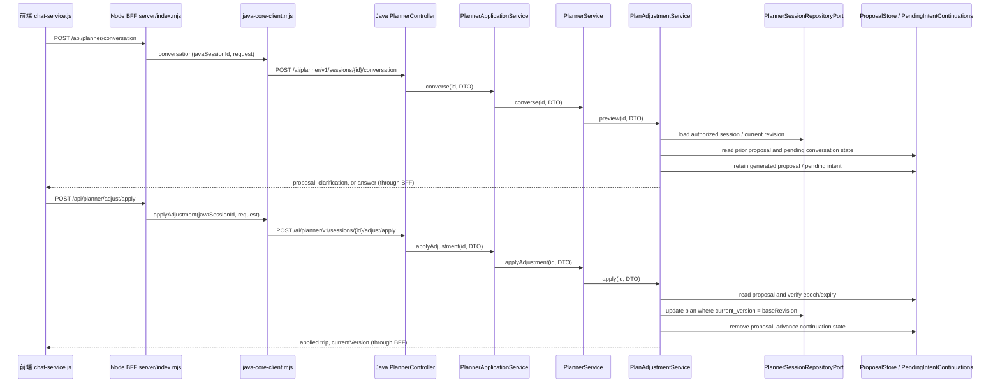

# CP0 调用链现状图

> 只读源码核对记录。核对时间：2026-10-09（Asia/Shanghai）。
> 范围：Java Planner 的 conversation / preview / apply 主链，以及 Web BFF 和前端实际入口。
> 本文新增于当前工作区；未运行 Maven、未执行运行时或多实例验证。源码行号按本次工作树读取结果记录。

## 1. 调用链总览

前端的常规聊天式调整实际走 `/api/planner/conversation`，这个 conversation 在 Java 内部复用 `PlanAdjustmentService.preview` 生成预览；用户确认才走 `/api/planner/adjust/apply`。另有一个独立的 `/api/planner/adjust/preview` BFF 与 Java API，但在本次检索的 `frontend/web/src` 中没有找到直接调用它的页面入口。此结论只覆盖该前端源码目录，不排除其他客户端调用。

## 2. 分层与职责的源码现状

### Java Web 适配层

- `PlannerController` 映射在 `/ai/planner/v1`，HTTP 路由包括 `/sessions/{id}/conversation`、`/sessions/{id}/adjust/preview`、`/sessions/{id}/adjust/apply`。控制器负责 DTO 默认值、从 `X-Plan-Session-Token` 补入会话凭证，并将服务结果转成 HTTP 响应。见 `ai/src/main/java/com/ai/guide/adapter/planner/web/PlannerController.java:45`、`:141`、`:152`、`:163`、`:174`。
- 当前工作树的控制器构造参数为 `PlanningApplicationService`（`:48-52`），但响应辅助方法仍以 `PlannerService.ServiceResult` 为参数（`:174-175`），因此 adapter 已经通过应用服务接口调用，返回契约仍引用 domain service 的具体嵌套类型。

### Java 应用层

- `PlanningApplicationService` 声明规划用例接口，包括 converse、preview、apply。见 `ai/src/main/java/com/ai/guide/application/planner/PlanningApplicationService.java:18-47`。
- `PlannerApplicationService` 实现该接口；本次查看到的方法基本直接转发给 `PlannerService`，例如 `converse`、`previewAdjustment`、`applyAdjustment`。见 `ai/src/main/java/com/ai/guide/application/planner/PlannerApplicationService.java:91-103`。
- 因此接口已提供一层注入边界，但当前结果类型和用例处理仍由 `PlannerService` 承载，应用服务自身尚未形成独立编排。

### PlannerService 到调整领域服务

- `PlannerService.converse` 与 `previewAdjustment` 都调用 `planAdjustmentService.preview`；`applyAdjustment` 调用 `planAdjustmentService.apply`。见 `ai/src/main/java/com/ai/guide/domain/planner/service/PlannerService.java:624-642`。
- `PlanAdjustmentService.preview` 执行会话授权读取、base revision 检查、对话重置/追问恢复、意图提取与约束解析，再生成或复用提案；入口及早期步骤见 `ai/src/main/java/com/ai/guide/domain/planner/service/PlanAdjustmentService.java:246-303`。
- `PlanAdjustmentService.apply` 按 session id 进入 128 桶 JVM 内锁后，校验授权、base revision、proposal 所属会话、有效期和 conversation epoch，再验证候选并请求仓储更新。见 `PlanAdjustmentService.java:694-746`、`:757-788`。

## 3. 前端与 BFF 的实际入口

- 前端发送聊天调整请求时携带 `sessionId`、当前 `trip.version` 作为 `baseRevision`、自然语言和活动日/选中站点/提案/待追问上下文、会话 token 与幂等键。见 `frontend/web/src/features/trip-chat/chat-service.js:613-632`。
- 前端应用提案时串行化 apply、生成并复用同一请求指纹的幂等键，携带 `proposalId`、`optionId`、`baseRevision` 与 token；回执必须满足 `currentVersion === baseRevision + 1` 才更新页面。见 `chat-service.js:976-1039`。
- BFF conversation 会恢复 Planner 会话，选出 Java session id，转发到 Java；当轮仍是最新时，把提案/追问上下文和更新时间写回 BFF Planner draft。见 `server/index.mjs:1695-1726`。
- BFF preview 路由恢复会话并转发 `javaCore.previewAdjustment`，然后直接返回结果。见 `server/index.mjs:1735-1753`。本次在 `frontend/web/src` 未找到该独立路由的直接调用。
- BFF apply 路由先校验会话与登录状态，转发至 Java；之后独立校验 Java 返回版本必须严格递增 1，再更新 BFF session 的 trip、syncRevision、提案和追问上下文并持久化。见 `server/index.mjs:1755-1792`。
- Java client 把三个 BFF 操作分别映射为 Java `/conversation`、`/adjust/preview`、`/adjust/apply`，并在请求 body 与 `X-Plan-Session-Token` header 中转递会话凭证。见 `server/java-core-client.mjs:80-115`、`:1216-1254`。

## 4. 版本与状态权威

1. 前端以 `state.trip.version` 发送 conversation / preview 的 `baseRevision`，apply 使用提案的 `baseRevision`。
2. Java apply 再次检查请求 revision 与会话版本、提案 revision 一致；行程更新由 `PlannerSessionRepository` 的 SQL 条件 `WHERE session_id = ? AND current_version = ?` 实施比较并交换，成功后写入新版本历史。见 `ai/src/main/java/com/ai/guide/infrastructure/planner/repository/PlannerSessionRepository.java:179-199`。
3. BFF apply 收到成功响应后要求版本恰好加一，再更新 BFF workspace 镜像。见 `server/index.mjs:1772-1792`。
4. 所以 Java Planner 数据库是规划版本并发校验的权威来源；BFF 同时持有需要同步的 Planner/session 工作区副本。当前源码显示双边都有版本检查与同步步骤，运行时故障时两份状态能否自动收敛，未通过本次只读静态查看验证。

## 5. 持久化、缓存与并发边界

| 状态 | 当前实现 | 本次确认到的限制 / 待核验点 |
|---|---|---|
| Planner 会话与版本 | `PlannerSessionRepositoryPort` 抽象；`PlannerSessionRepository` JDBC 存储计划 JSON、currentVersion 与 revision history。接口仍以 `Map<String,Object>` 承载 trip/constraints，见 `ai/src/main/java/com/ai/guide/domain/planner/gateway/PlannerSessionRepositoryPort.java:16-20`、`:60-68`。 | 持久化使用 CAS 版本条件；未运行并发竞争实验。 |
| Proposal | `ProposalStore` 有 Caffeine L1，Redis L2 写入为 `CompletableFuture.runAsync`；读取先查 L1 再 Redis。见 `ai/src/main/java/com/ai/guide/domain/planner/service/ProposalStore.java:26-61`、`:64-95`。 | 提案不是强一致的唯一持久化记录；异步写 Redis 有短暂窗口。真实 Redis 是否启用、跨进程恢复是否稳定，本次未验证。 |
| apply 幂等回放 | `PlanAdjustmentService.applyReplays` 为 JVM 内有界 map，session apply 锁也是 JVM 内 128 桶锁。见 `PlanAdjustmentService.java:80-88`、`:694-699`。 | 多实例之间不共享回放缓存/锁；DB CAS 可以阻止同一旧版本被重复升版，但网络重试是否返回同一个成功回执未由静态检查证实。 |
| pending intent / conversation epoch | `PendingIntentContinuations` 的 generations、epochs 与追问状态保存在实例内 map。见 `ai/src/main/java/com/ai/guide/domain/planner/service/PendingIntentContinuations.java:8-16`、`:27-42`、`:56-73`。 | 重启/换实例恢复追问与 proposal epoch 的具体用户体验尚未实测；应在后续阶段明确持久化或重新预览的契约。 |
| BFF Planner 工作区镜像 | BFF 对话与 apply 路由会调用 `savePlannerDraft` 和 `persistFormalTripWorkspace`。见 `server/index.mjs:1723-1726`、`:1782-1791`。 | 这里与 Java 会话并存两份可变状态；数据库提交成功而 BFF 写回失败、或反过来的故障恢复时序，未做故障注入。 |

## 6. 本次只读核验结论

- 当前已存在端口/适配器方向：HTTP Controller → application interface → PlannerService → session repository port/JDBC adapter；ProposalStore 仍是 domain service 中直接使用的 `@Component`，直接依赖 Caffeine、RedisTemplate、Jackson。
- 应用接口是有效的 controller 注入点，但当前它基本只转发，且接口与 Controller 仍暴露 `PlannerService.ServiceResult`。后续切片可先把 transport-neutral 的用例结果搬到 application 契约，再逐步将会话读取、授权上下文、状态保存、缓存/追问状态的编排从 `PlannerService`/`PlanAdjustmentService` 拆清。
- 数据版本正确性的最后门禁已落在 JDBC CAS；BFF 还有自己的同步版本校验。重构时需维持这两个边界，并专门验证 DB 写入后 BFF 持久化失败的恢复行为。
- 当前业务工作树有未提交变更。尤其 `PlannerController.java`、`PlannerApplicationService.java`、`PlanningApplicationService.java` 正处于修改态；因此本报告描述“本次读取到的工作树”，不等价于已提交版本或可构建状态。

## 7. 技术版本与证据边界

- Java：项目声明 `java.version=17`。见 `D:/scenic-guide/pom.xml:19`。
- Spring Boot：dependency management 版本 `3.4.1`。见 `D:/scenic-guide/pom.xml:29`、`:42`。
- Spring AI：项目声明 `1.0.0-M3`。见 `D:/scenic-guide/pom.xml:20`、`D:/scenic-guide/ai/pom.xml:17`。
- ArchUnit 测试依赖声明 `1.3.0`。见 `D:/scenic-guide/ai/pom.xml:193-195`。
- Node.js 的实际运行版本本次未读取；未从源码推断。
- 本次未运行 Maven、Node 测试、服务、浏览器或并发探针。所有“通过/成功”仅指源码中可见的检查分支，不是执行验证结论。
